# Diagramas

Generados con [`generar_diagramas.py`](generar_diagramas.py) a partir del esquema real de SQL Server y de las entidades JPA,
por lo que se mantienen coherentes con [`../03-modelo-de-datos.md`](../03-modelo-de-datos.md) (CA-00.5.1).

| Archivo | Contenido | Cómo abrirlo |
|---|---|---|
| [`er.drawio`](er.drawio) | Modelo entidad-relación agrupado por módulo (43 tablas, 59 relaciones) | draw.io / diagrams.net |
| [`clases.drawio`](clases.drawio) | Página «Dominio»: 42 clases por paquete · Página «Capas (MVC)»: controller → service → dao por módulo | draw.io / diagrams.net |

Para regenerarlos (con la base levantada):

```bash
python -I docs/diagramas/generar_diagramas.py --password "<contraseña de sa>"
```

## Modelo E-R

```mermaid
erDiagram
    usuario ||--o| administrador : "usuario_id"
    usuario |o--o{ alerta : "destinatario_usuario_id"
    grupo_alimento ||--o{ alimento : "grupo_alimento_id"
    profesional ||--o{ bloqueo_agenda : "profesional_id"
    paciente ||--o{ cargo : "paciente_id"
    arancel |o--o{ cargo : "arancel_id"
    paciente ||--o{ comentario : "paciente_id"
    plan_alimentario |o--o{ comentario : "plan_id"
    comida_plan |o--o{ comentario : "comida_plan_id"
    rutina |o--o{ comentario : "rutina_id"
    ejercicio_rutina |o--o{ comentario : "ejercicio_rutina_id"
    plan_alimentario ||--o{ comida_plan : "plan_id"
    rutina ||--o{ dia_rutina : "rutina_id"
    profesional ||--o{ disponibilidad : "profesional_id"
    grupo_muscular ||--o{ ejercicio : "grupo_muscular_principal_id"
    ejercicio ||--o{ ejercicio_grupo_secundario : "ejercicio_id"
    grupo_muscular ||--o{ ejercicio_grupo_secundario : "grupo_muscular_id"
    dia_rutina ||--o{ ejercicio_rutina : "dia_rutina_id"
    ejercicio ||--o{ ejercicio_rutina : "ejercicio_id"
    alimento ||--o{ equivalencia_manual : "alimento_id"
    alimento ||--o{ equivalencia_manual : "alimento_equivalente_id"
    paciente ||--o{ evaluacion_fisica : "paciente_id"
    profesional ||--o{ evaluacion_fisica : "profesional_id"
    ejercicio |o--o{ evaluacion_fisica : "ejercicio_id"
    comida_plan ||--o{ item_comida : "comida_plan_id"
    alimento ||--o{ item_comida : "alimento_id"
    paciente ||--o{ medicion_antropometrica : "paciente_id"
    profesional ||--o{ medicion_antropometrica : "profesional_id"
    paciente ||--o{ molestia : "paciente_id"
    ejercicio_rutina |o--o{ molestia : "ejercicio_rutina_id"
    usuario |o--o{ notificacion : "usuario_id"
    paciente ||--o{ observacion_diaria : "paciente_id"
    usuario ||--o| paciente : "usuario_id"
    paciente ||--o{ paciente_profesional : "paciente_id"
    profesional ||--o{ paciente_profesional : "profesional_id"
    paciente ||--o{ pago : "paciente_id"
    paciente ||--o{ plan_alimentario : "paciente_id"
    profesional ||--o{ plan_alimentario : "nutricionista_id"
    usuario ||--o| profesional : "usuario_id"
    item_comida ||--o{ reemplazo_alimento : "item_comida_id"
    alimento ||--o{ reemplazo_alimento : "alimento_reemplazo_id"
    paciente ||--o{ reemplazo_alimento : "paciente_id"
    ejercicio_rutina ||--o{ reemplazo_ejercicio : "ejercicio_rutina_id"
    ejercicio ||--o{ reemplazo_ejercicio : "ejercicio_reemplazo_id"
    paciente ||--o{ reemplazo_ejercicio : "paciente_id"
    paciente ||--o{ registro_comida : "paciente_id"
    comida_plan ||--o{ registro_comida : "comida_plan_id"
    paciente ||--o{ registro_entrenamiento : "paciente_id"
    ejercicio_rutina ||--o{ registro_entrenamiento : "ejercicio_rutina_id"
    ejercicio ||--o{ registro_entrenamiento : "ejercicio_id"
    paciente ||--o{ rutina : "paciente_id"
    profesional ||--o{ rutina : "entrenador_id"
    usuario ||--o{ token_recupero : "usuario_id"
    paciente ||--o{ turno : "paciente_id"
    profesional ||--o{ turno : "profesional_id"
    usuario |o--o{ turno : "cancelado_por_usuario_id"
    usuario |o--o{ turno : "creado_por_usuario_id"
    turno ||--o{ turno_historial : "turno_id"
    usuario ||--o{ usuario_rol : "usuario_id"
    administrador {
        BIGINT id PK
        BIGINT usuario_id FK,UK
        NVARCHAR_80 nombre
        NVARCHAR_80 apellido
        NVARCHAR_1024 telefono
    }
    alerta {
        BIGINT id PK
        BIGINT destinatario_usuario_id FK
        NVARCHAR_30 tipo
        NVARCHAR_500 mensaje
        BIT prioritaria
        NVARCHAR_40 referencia_tipo
        BIGINT referencia_id
        DATETIME2_0 created_at
        DATETIME2_0 leida_at
    }
    alimento {
        BIGINT id PK
        NVARCHAR_120 nombre UK
        NVARCHAR_120 nombre_normalizado UK
        BIGINT grupo_alimento_id FK
        DECIMAL_7_2 kcal_100g
        DECIMAL_7_2 hc_100g
        DECIMAL_7_2 proteinas_100g
        DECIMAL_7_2 grasas_100g
        DECIMAL_7_2 fibra_100g
        DECIMAL_8_2 sodio_mg_100g
        NVARCHAR_60 unidad_casera
        DECIMAL_7_1 gramos_unidad_casera
        BIT apto_desayuno
        BIT apto_colacion
        BIT apto_almuerzo
        BIT activo
        DATETIME2_0 created_at
        NVARCHAR_40 created_by
        DATETIME2_0 updated_at
        NVARCHAR_40 updated_by
        INT version
    }
    arancel {
        BIGINT id PK
        NVARCHAR_100 concepto
        DECIMAL_12_2 monto
        DATE vigente_desde
        BIT activo
        DATETIME2_0 created_at
        NVARCHAR_40 created_by
        DATETIME2_0 updated_at
        NVARCHAR_40 updated_by
        INT version
    }
    backup_registro {
        BIGINT id PK
        NVARCHAR_12 tipo
        DATETIME2_0 iniciado_at
        DATETIME2_0 finalizado_at
        NVARCHAR_10 estado
        NVARCHAR_200 archivo
        BIGINT tamano_bytes
        NVARCHAR_400 ubicacion
        NVARCHAR_40 solicitado_por
        NVARCHAR_1000 error
        BIT expirado
    }
    bitacora_evento {
        BIGINT id PK
        DATETIME2_0 fecha_hora
        BIGINT usuario_id
        NVARCHAR_40 username
        NVARCHAR_100 roles
        NVARCHAR_20 modulo
        NVARCHAR_20 tipo_evento
        NVARCHAR_40 entidad
        NVARCHAR_40 entidad_id
        NVARCHAR_500 descripcion
        NVARCHAR_10 resultado
        NVARCHAR_60 ip
        NVARCHAR_MAX detalle
    }
    bloqueo_agenda {
        BIGINT id PK
        BIGINT profesional_id FK
        DATETIME2_0 desde
        DATETIME2_0 hasta
        NVARCHAR_200 motivo
    }
    cargo {
        BIGINT id PK
        BIGINT paciente_id FK
        NVARCHAR_100 concepto
        NVARCHAR_7 periodo
        DECIMAL_12_2 monto
        DATE fecha
        DATE vencimiento
        BIGINT arancel_id FK
        BIT anulado
        NVARCHAR_200 motivo_anulacion
        DATETIME2_0 created_at
        NVARCHAR_40 created_by
        DATETIME2_0 updated_at
        NVARCHAR_40 updated_by
        INT version
    }
    comentario {
        BIGINT id PK
        BIGINT paciente_id FK
        NVARCHAR_10 tipo
        BIGINT plan_id FK
        BIGINT comida_plan_id FK
        BIGINT rutina_id FK
        BIGINT ejercicio_rutina_id FK
        DATE fecha
        NVARCHAR_300 texto
        DATETIME2_0 created_at
        DATETIME2_0 leido_at
        NVARCHAR_40 leido_por
    }
    comida_plan {
        BIGINT id PK
        BIGINT plan_id FK
        INT dia_semana
        NVARCHAR_20 tipo_comida
        INT orden
        NVARCHAR_500 descripcion
        DECIMAL_7_1 kcal_estimadas
        BIT activo
    }
    configuracion_sistema {
        NVARCHAR_80 clave PK
        NVARCHAR_500 valor
        NVARCHAR_200 descripcion
        DATETIME2_0 updated_at
        NVARCHAR_40 updated_by
    }
    dia_rutina {
        BIGINT id PK
        BIGINT rutina_id FK
        INT dia_semana
        NVARCHAR_80 nombre
        INT orden
        BIT activo
    }
    disponibilidad {
        BIGINT id PK
        BIGINT profesional_id FK
        INT dia_semana
        TIME_0 hora_desde
        TIME_0 hora_hasta
        NVARCHAR_120 ubicacion
        BIT activo
    }
    ejercicio {
        BIGINT id PK
        NVARCHAR_120 nombre UK
        NVARCHAR_120 nombre_normalizado UK
        NVARCHAR_500 descripcion
        BIGINT grupo_muscular_principal_id FK
        NVARCHAR_10 dificultad
        NVARCHAR_100 equipamiento
        NVARCHAR_300 video_url
        BIT activo
        DATETIME2_0 created_at
        NVARCHAR_40 created_by
        DATETIME2_0 updated_at
        NVARCHAR_40 updated_by
        INT version
    }
    ejercicio_grupo_secundario {
        BIGINT ejercicio_id PK,FK
        BIGINT grupo_muscular_id PK,FK
    }
    ejercicio_rutina {
        BIGINT id PK
        BIGINT dia_rutina_id FK
        BIGINT ejercicio_id FK
        INT orden
        INT series
        NVARCHAR_20 repeticiones
        INT descanso_seg
        NVARCHAR_30 carga_sugerida
        NVARCHAR_300 notas
        BIT activo
    }
    equivalencia_manual {
        BIGINT id PK
        BIGINT alimento_id FK
        BIGINT alimento_equivalente_id FK
        DECIMAL_7_1 gramos_origen
        DECIMAL_7_1 gramos_equivalente
        NVARCHAR_120 nota
    }
    evaluacion_fisica {
        BIGINT id PK
        BIGINT paciente_id FK
        BIGINT profesional_id FK
        DATE fecha
        NVARCHAR_80 prueba
        BIGINT ejercicio_id FK
        DECIMAL_8_2 valor
        NVARCHAR_15 unidad
        NVARCHAR_300 observaciones
        DATETIME2_0 created_at
        NVARCHAR_40 created_by
        DATETIME2_0 updated_at
        NVARCHAR_40 updated_by
        INT version
    }
    grupo_alimento {
        BIGINT id PK
        NVARCHAR_60 nombre UK
        NVARCHAR_12 macro_referencia
        NVARCHAR_200 descripcion
    }
    grupo_muscular {
        BIGINT id PK
        NVARCHAR_60 nombre UK
    }
    item_comida {
        BIGINT id PK
        BIGINT comida_plan_id FK
        BIGINT alimento_id FK
        DECIMAL_7_1 gramos
        NVARCHAR_60 cantidad_casera
        INT orden
        BIT activo
    }
    medicion_antropometrica {
        BIGINT id PK
        BIGINT paciente_id FK
        BIGINT profesional_id FK
        DATE fecha
        DECIMAL_5_2 peso_kg
        DECIMAL_5_1 talla_cm
        DECIMAL_4_1 imc
        DECIMAL_4_1 pct_grasa
        DECIMAL_4_1 pct_musculo
        DECIMAL_5_1 circ_cintura_cm
        DECIMAL_5_1 circ_cadera_cm
        DECIMAL_5_1 circ_brazo_cm
        DECIMAL_5_1 circ_muslo_cm
        DECIMAL_5_1 circ_pecho_cm
        DECIMAL_5_1 circ_pantorrilla_cm
        NVARCHAR_4000 observaciones
        DATETIME2_0 created_at
        NVARCHAR_40 created_by
        DATETIME2_0 updated_at
        NVARCHAR_40 updated_by
        INT version
    }
    molestia {
        BIGINT id PK
        BIGINT paciente_id FK
        DATE fecha
        NVARCHAR_300 descripcion
        INT intensidad
        NVARCHAR_60 ubicacion_corporal
        BIGINT ejercicio_rutina_id FK
        NVARCHAR_15 contexto
        DATETIME2_0 created_at
        DATETIME2_0 revisada_at
        NVARCHAR_40 revisada_por
    }
    notificacion {
        BIGINT id PK
        NVARCHAR_30 tipo
        BIGINT usuario_id FK
        NVARCHAR_120 destinatario
        NVARCHAR_1024 telefono
        NVARCHAR_60 plantilla
        NVARCHAR_MAX parametros
        NVARCHAR_40 referencia_tipo
        BIGINT referencia_id
        NVARCHAR_12 estado
        INT intentos
        DATETIME2_0 proximo_intento_at
        NVARCHAR_500 error
        NVARCHAR_120 wa_message_id
        DATETIME2_0 created_at
        DATETIME2_0 enviada_at
    }
    observacion_diaria {
        BIGINT id PK
        BIGINT paciente_id FK
        DATE fecha
        INT nivel_hambre
        INT nivel_saciedad
        INT estado_animo
        NVARCHAR_300 comentario
    }
    paciente {
        BIGINT id PK
        BIGINT usuario_id FK,UK
        NVARCHAR_80 nombre
        NVARCHAR_80 apellido
        NVARCHAR_10 tipo_documento
        NVARCHAR_20 nro_documento UK
        DATE fecha_nacimiento
        NVARCHAR_10 sexo
        NVARCHAR_1024 telefono_whatsapp
        NVARCHAR_1024 email
        NVARCHAR_1024 domicilio
        NVARCHAR_300 objetivo
        NVARCHAR_4000 antecedentes_salud
        NVARCHAR_4000 observaciones
        NVARCHAR_10 estado
        DATE fecha_baja
        NVARCHAR_300 motivo_baja
        DATETIME2_0 created_at
        NVARCHAR_40 created_by
        DATETIME2_0 updated_at
        NVARCHAR_40 updated_by
        INT version
    }
    paciente_profesional {
        BIGINT id PK
        BIGINT paciente_id FK
        BIGINT profesional_id FK
        NVARCHAR_15 area
        DATE fecha_asignacion
        BIT activo
    }
    pago {
        BIGINT id PK
        BIGINT paciente_id FK
        DATE fecha
        DECIMAL_12_2 monto
        NVARCHAR_15 medio
        NVARCHAR_60 referencia
        NVARCHAR_300 observaciones
        BIGINT nro_comprobante UK
        BIT anulado
        NVARCHAR_200 motivo_anulacion
        DATETIME2_0 created_at
        NVARCHAR_40 created_by
        DATETIME2_0 updated_at
        NVARCHAR_40 updated_by
        INT version
    }
    plan_alimentario {
        BIGINT id PK
        BIGINT paciente_id FK
        BIGINT nutricionista_id FK
        NVARCHAR_120 nombre
        DATE fecha_inicio
        INT duracion_semanas
        DATE fecha_fin
        NVARCHAR_12 modo
        INT kcal_objetivo
        DECIMAL_5_2 pct_hc
        DECIMAL_5_2 pct_proteinas
        DECIMAL_5_2 pct_grasas
        NVARCHAR_2000 parametros_generacion
        NVARCHAR_12 estado
        NVARCHAR_1000 observaciones
        DATETIME2_0 created_at
        NVARCHAR_40 created_by
        DATETIME2_0 updated_at
        NVARCHAR_40 updated_by
        INT version
    }
    profesional {
        BIGINT id PK
        BIGINT usuario_id FK,UK
        NVARCHAR_80 nombre
        NVARCHAR_80 apellido
        NVARCHAR_10 tipo_documento
        NVARCHAR_20 nro_documento UK
        NVARCHAR_30 matricula
        NVARCHAR_15 tipo
        NVARCHAR_100 especialidad
        NVARCHAR_1024 telefono_whatsapp
        NVARCHAR_1024 email
        INT duracion_turno_min
        NVARCHAR_10 estado
        DATE fecha_baja
        DATETIME2_0 created_at
        NVARCHAR_40 created_by
        DATETIME2_0 updated_at
        NVARCHAR_40 updated_by
        INT version
    }
    reemplazo_alimento {
        BIGINT id PK
        BIGINT item_comida_id FK
        BIGINT alimento_reemplazo_id FK
        DECIMAL_7_1 gramos
        NVARCHAR_60 cantidad_casera
        BIGINT paciente_id FK
        DATE fecha_desde
        BIT activo
    }
    reemplazo_ejercicio {
        BIGINT id PK
        BIGINT ejercicio_rutina_id FK
        BIGINT ejercicio_reemplazo_id FK
        BIGINT paciente_id FK
        DATE fecha
        BIT activo
    }
    registro_acceso {
        BIGINT id PK
        DATETIME2_0 fecha_hora
        BIGINT usuario_id
        NVARCHAR_40 username_intentado
        NVARCHAR_100 roles
        NVARCHAR_60 ip
        NVARCHAR_300 user_agent
        NVARCHAR_30 accion
        NVARCHAR_300 detalle
    }
    registro_comida {
        BIGINT id PK
        BIGINT paciente_id FK
        BIGINT comida_plan_id FK
        DATE fecha
        BIT realizada
        BIT no_le_gusto
        BIT le_cayo_mal
        DATETIME2_0 created_at
    }
    registro_entrenamiento {
        BIGINT id PK
        BIGINT paciente_id FK
        BIGINT ejercicio_rutina_id FK
        BIGINT ejercicio_id FK
        DATE fecha
        BIT completado
        INT series_realizadas
        INT repeticiones_realizadas
        DECIMAL_6_2 carga_kg
        DATETIME2_0 created_at
    }
    rutina {
        BIGINT id PK
        BIGINT paciente_id FK
        BIGINT entrenador_id FK
        NVARCHAR_120 nombre
        NVARCHAR_300 objetivo
        DATE fecha_inicio
        INT duracion_semanas
        DATE fecha_fin
        NVARCHAR_12 estado
        NVARCHAR_1000 observaciones
        DATETIME2_0 created_at
        NVARCHAR_40 created_by
        DATETIME2_0 updated_at
        NVARCHAR_40 updated_by
        INT version
    }
    terminos_condiciones {
        NVARCHAR_10 version PK
        NVARCHAR_MAX texto
        DATETIME2_0 vigente_desde
    }
    token_recupero {
        BIGINT id PK
        BIGINT usuario_id FK
        NVARCHAR_64 token_hash UK
        DATETIME2_0 expira_at
        DATETIME2_0 usado_at
        NVARCHAR_20 canal
        DATETIME2_0 created_at
    }
    token_revocado {
        NVARCHAR_36 jti PK
        DATETIME2_0 expira_at
    }
    turno {
        BIGINT id PK
        BIGINT paciente_id FK
        BIGINT profesional_id FK
        NVARCHAR_15 area
        DATETIME2_0 inicio
        DATETIME2_0 fin
        NVARCHAR_120 ubicacion
        NVARCHAR_12 estado
        NVARCHAR_200 motivo_cancelacion
        BIGINT cancelado_por_usuario_id FK
        NVARCHAR_20 cancelado_por_rol
        DATETIME2_0 recordatorio_enviado_at
        BIGINT creado_por_usuario_id FK
        BIT fuera_de_agenda
        DATETIME2_0 created_at
        NVARCHAR_40 created_by
        DATETIME2_0 updated_at
        NVARCHAR_40 updated_by
        INT version
    }
    turno_historial {
        BIGINT id PK
        BIGINT turno_id FK
        DATETIME2_0 inicio_anterior
        DATETIME2_0 fin_anterior
        NVARCHAR_200 motivo
        NVARCHAR_40 cambiado_por
        DATETIME2_0 cambiado_at
    }
    usuario {
        BIGINT id PK
        NVARCHAR_20 username UK
        NVARCHAR_100 password_hash
        NVARCHAR_20 estado
        BIT debe_cambiar_password
        INT intentos_fallidos
        DATETIME2_0 bloqueado_hasta
        NVARCHAR_10 terminos_version_aceptada
        DATETIME2_0 terminos_aceptados_at
        DATETIME2_0 ultimo_acceso_at
        DATETIME2_0 tokens_validos_desde
        DATETIME2_0 created_at
        NVARCHAR_40 created_by
        DATETIME2_0 updated_at
        NVARCHAR_40 updated_by
        INT version
    }
    usuario_rol {
        BIGINT usuario_id PK,FK
        NVARCHAR_20 rol PK
    }
```

## Clases del dominio

```mermaid
classDiagram
    direction LR
    class BackupRegistro {
        +Long id
        +Tipo tipo
        +Instant iniciadoAt
        +Instant finalizadoAt
        +Estado estado
        +String archivo
        +Long tamanoBytes
        +String ubicacion
        +String solicitadoPor
        +String error
        +boolean expirado
    }
    class BitacoraEvento {
        +Long id
        +Instant fechaHora
        +Long usuarioId
        +String username
        +String roles
        +Modulo modulo
        +TipoEvento tipoEvento
        +String entidad
        +String entidadId
        +String descripcion
        +Resultado resultado
        +String ip
        +String detalle
    }
    class Modulo {
        <<enumeration>>
        PACIENTES
        PROFESIONALES
        TURNOS
        NUTRICION
        ENTRENAMIENTO
        EVOLUCION
        PAGOS
        CATALOGO
        NOTIFICACIONES
        REPORTES
        SEGURIDAD
        BACKUP
        CONFIGURACION
    }
    class TipoEvento {
        <<enumeration>>
        ALTA
        BAJA
        MODIFICACION
        CONSULTA_SENSIBLE
        REPORTE
        DESCARGA
        CAMBIO_PASSWORD
        CONFIGURACION
        NOTIFICACION
        BACKUP
        ERROR
    }
    class Alimento {
        +Long id
        +String nombre
        +String nombreNormalizado
        +GrupoAlimento grupo
        +BigDecimal kcal
        +BigDecimal hc
        +BigDecimal proteinas
        +BigDecimal grasas
        +BigDecimal fibra
        +BigDecimal sodioMg
        +String unidadCasera
        +BigDecimal gramosUnidadCasera
        +boolean aptoDesayuno
        +boolean aptoColacion
        +boolean aptoAlmuerzo
        +boolean activo
        +referenciaPorGramo()
    }
    class Ejercicio {
        +Long id
        +String nombre
        +String nombreNormalizado
        +String descripcion
        +GrupoMuscular grupoPrincipal
        +Set~GrupoMuscular~ gruposSecundarios
        +Dificultad dificultad
        +String equipamiento
        +String videoUrl
        +boolean activo
    }
    class EquivalenciaManual {
        +Long id
        +Long alimentoId
        +Long alimentoEquivalenteId
        +BigDecimal gramosOrigen
        +BigDecimal gramosEquivalente
        +String nota
    }
    class GrupoAlimento {
        +Long id
        +String nombre
        +Macro macroReferencia
        +String descripcion
    }
    class GrupoMuscular {
        +Long id
        +String nombre
    }
    class ConfiguracionSistema {
        +String clave
        +String valor
        +String descripcion
        +Instant updatedAt
        +String updatedBy
    }
    class TerminosCondiciones {
        +String version
        +String texto
        +Instant vigenteDesde
    }
    class DiaRutina {
        +Long id
        +Rutina rutina
        +int diaSemana
        +String nombre
        +int orden
        +boolean activo
        +List~EjercicioRutina~ ejercicios
        +ejerciciosActivos()
    }
    class EjercicioRutina {
        +Long id
        +DiaRutina dia
        +Long ejercicioId
        +int orden
        +int series
        +String repeticiones
        +Integer descansoSeg
        +String cargaSugerida
        +String notas
        +boolean activo
    }
    class ReemplazoEjercicio {
        +Long id
        +Long ejercicioRutinaId
        +Long ejercicioReemplazoId
        +Long pacienteId
        +LocalDate fecha
        +boolean activo
    }
    class RegistroEntrenamiento {
        +Long id
        +Long pacienteId
        +Long ejercicioRutinaId
        +Long ejercicioId
        +LocalDate fecha
        +boolean completado
        +Integer seriesRealizadas
        +Integer repeticionesRealizadas
        +BigDecimal cargaKg
        +Instant createdAt
    }
    class Rutina {
        +Long id
        +Long pacienteId
        +Long entrenadorId
        +String nombre
        +String objetivo
        +LocalDate fechaInicio
        +int duracionSemanas
        +LocalDate fechaFin
        +Estado estado
        +String observaciones
        +List~DiaRutina~ dias
        +recalcularFin()
        +diasActivos()
    }
    class EvaluacionFisica {
        +Long id
        +Long pacienteId
        +Long profesionalId
        +LocalDate fecha
        +String prueba
        +Long ejercicioId
        +BigDecimal valor
        +String unidad
        +String observaciones
    }
    class MedicionAntropometrica {
        +Long id
        +Long pacienteId
        +Long profesionalId
        +LocalDate fecha
        +BigDecimal pesoKg
        +BigDecimal tallaCm
        +BigDecimal imc
        +BigDecimal pctGrasa
        +BigDecimal pctMusculo
        +BigDecimal circCintura
        +BigDecimal circCadera
        +BigDecimal circBrazo
        +BigDecimal circMuslo
        +BigDecimal circPecho
        +BigDecimal circPantorrilla
        +String observaciones
    }
    class Alerta {
        +Long id
        +Long destinatarioUsuarioId
        +Tipo tipo
        +String mensaje
        +boolean prioritaria
        +String referenciaTipo
        +Long referenciaId
        +Instant createdAt
        +Instant leidaAt
    }
    class Notificacion {
        +Long id
        +TipoNotificacion tipo
        +Long usuarioId
        +String destinatario
        +String telefono
        +String plantilla
        +String parametros
        +String referenciaTipo
        +Long referenciaId
        +Estado estado
        +int intentos
        +Instant proximoIntentoAt
        +String error
        +String waMessageId
        +Instant createdAt
        +Instant enviadaAt
    }
    class TipoNotificacion {
        <<enumeration>>
        CREDENCIALES
        TURNO_CONFIRMADO
        TURNO_REPROGRAMADO
        TURNO_CANCELADO
        RECORDATORIO_TURNO
        RECORDATORIO_DEUDA
        CAMBIO_ARANCEL
        RECUPERO_PASSWORD
    }
    class Comentario {
        +Long id
        +Long pacienteId
        +Tipo tipo
        +Long planId
        +Long comidaPlanId
        +Long rutinaId
        +Long ejercicioRutinaId
        +LocalDate fecha
        +String texto
        +Instant createdAt
        +Instant leidoAt
        +String leidoPor
    }
    class Molestia {
        +Long id
        +Long pacienteId
        +LocalDate fecha
        +String descripcion
        +int intensidad
        +String ubicacionCorporal
        +Long ejercicioRutinaId
        +Contexto contexto
        +Instant createdAt
        +Instant revisadaAt
        +String revisadaPor
    }
    class ComidaPlan {
        +Long id
        +PlanAlimentario plan
        +int diaSemana
        +TipoComida tipo
        +int orden
        +String descripcion
        +BigDecimal kcalEstimadas
        +boolean activo
        +List~ItemComida~ items
        +itemsActivos()
        +tieneContenido()
    }
    class ItemComida {
        +Long id
        +ComidaPlan comida
        +Long alimentoId
        +BigDecimal gramos
        +String cantidadCasera
        +int orden
        +boolean activo
    }
    class ObservacionDiaria {
        +Long id
        +Long pacienteId
        +LocalDate fecha
        +int nivelHambre
        +int nivelSaciedad
        +Integer estadoAnimo
        +String comentario
    }
    class PlanAlimentario {
        +Long id
        +Long pacienteId
        +Long nutricionistaId
        +String nombre
        +LocalDate fechaInicio
        +int duracionSemanas
        +LocalDate fechaFin
        +Modo modo
        +Integer kcalObjetivo
        +BigDecimal pctHc
        +BigDecimal pctProteinas
        +BigDecimal pctGrasas
        +String parametrosGeneracion
        +Estado estado
        +String observaciones
        +List~ComidaPlan~ comidas
        +recalcularFin()
        +comidasActivas()
    }
    class ReemplazoAlimento {
        +Long id
        +Long itemComidaId
        +Long alimentoReemplazoId
        +BigDecimal gramos
        +String cantidadCasera
        +Long pacienteId
        +LocalDate fechaDesde
        +boolean activo
    }
    class RegistroComida {
        +Long id
        +Long pacienteId
        +Long comidaPlanId
        +LocalDate fecha
        +boolean realizada
        +boolean noLeGusto
        +boolean leCayoMal
        +Instant createdAt
    }
    class TipoComida {
        <<enumeration>>
        DESAYUNO
        COLACION_MANANA
        ALMUERZO
        MERIENDA
        COLACION_TARDE
        CENA
    }
    class Paciente {
        +Long id
        +Long usuarioId
        +String nombre
        +String apellido
        +String tipoDocumento
        +String nroDocumento
        +LocalDate fechaNacimiento
        +String sexo
        +String telefonoWhatsapp
        +String email
        +String domicilio
        +String objetivo
        +String antecedentesSalud
        +String observaciones
        +Estado estado
        +LocalDate fechaBaja
        +String motivoBaja
        +nombreCompleto()
        +edad()
        +activo()
    }
    class PacienteProfesional {
        +Long id
        +Long pacienteId
        +Long profesionalId
        +Area area
        +LocalDate fechaAsignacion
        +boolean activo
    }
    class Arancel {
        +Long id
        +String concepto
        +BigDecimal monto
        +LocalDate vigenteDesde
        +boolean activo
    }
    class Cargo {
        +Long id
        +Long pacienteId
        +String concepto
        +String periodo
        +BigDecimal monto
        +LocalDate fecha
        +LocalDate vencimiento
        +Long arancelId
        +boolean anulado
        +String motivoAnulacion
    }
    class Pago {
        +Long id
        +Long pacienteId
        +LocalDate fecha
        +BigDecimal monto
        +Medio medio
        +String referencia
        +String observaciones
        +Long nroComprobante
        +boolean anulado
        +String motivoAnulacion
    }
    class BloqueoAgenda {
        +Long id
        +Long profesionalId
        +Instant desde
        +Instant hasta
        +String motivo
        +solapa()
    }
    class Disponibilidad {
        +Long id
        +Long profesionalId
        +int diaSemana
        +LocalTime horaDesde
        +LocalTime horaHasta
        +String ubicacion
        +boolean activo
    }
    class Profesional {
        +Long id
        +Long usuarioId
        +String nombre
        +String apellido
        +String tipoDocumento
        +String nroDocumento
        +String matricula
        +Tipo tipo
        +String especialidad
        +String telefonoWhatsapp
        +String email
        +int duracionTurnoMin
        +Estado estado
        +LocalDate fechaBaja
        +nombreCompleto()
        +nombreVisible()
        +activo()
    }
    class Administrador {
        +Long id
        +Long usuarioId
        +String nombre
        +String apellido
        +String telefono
    }
    class RegistroAcceso {
        +Long id
        +Instant fechaHora
        +Long usuarioId
        +String usernameIntentado
        +String roles
        +String ip
        +String userAgent
        +Accion accion
        +String detalle
    }
    class TokenRecupero {
        +Long id
        +Long usuarioId
        +String tokenHash
        +Instant expiraAt
        +Instant usadoAt
        +String canal
        +Instant createdAt
    }
    class TokenRevocado {
        +String jti
        +Instant expiraAt
    }
    class Usuario {
        +Long id
        +String username
        +String passwordHash
        +Estado estado
        +boolean debeCambiarPassword
        +int intentosFallidos
        +Instant bloqueadoHasta
        +String terminosVersionAceptada
        +Instant terminosAceptadosAt
        +Instant ultimoAccesoAt
        +Instant tokensValidosDesde
        +Set~Rol~ roles
        +tieneRol()
        +reemplazarRoles()
    }
    class Turno {
        +Long id
        +Long pacienteId
        +Long profesionalId
        +Area area
        +Instant inicio
        +Instant fin
        +String ubicacion
        +Estado estado
        +String motivoCancelacion
        +Long canceladoPorUsuarioId
        +String canceladoPorRol
        +Instant recordatorioEnviadoAt
        +Long creadoPorUsuarioId
        +boolean fueraDeAgenda
        +solapa()
    }
    class TurnoHistorial {
        +Long id
        +Long turnoId
        +Instant inicioAnterior
        +Instant finAnterior
        +String motivo
        +String cambiadoPor
        +Instant cambiadoAt
    }
    class EntidadAuditada {
        +Instant createdAt
        +String createdBy
        +Instant updatedAt
        +String updatedBy
        +Integer version
    }
    <<abstract>> EntidadAuditada
    BitacoraEvento "*" ..> "1" Usuario : usuarioId
    EntidadAuditada <|-- Alimento
    Alimento "*" --> "1" GrupoAlimento : grupo
    EntidadAuditada <|-- Ejercicio
    Ejercicio "*" --> "1" GrupoMuscular : grupoPrincipal
    EquivalenciaManual "*" ..> "1" Alimento : alimentoId
    EquivalenciaManual "*" ..> "1" Alimento : alimentoEquivalenteId
    DiaRutina "1" *-- "*" EjercicioRutina : ejercicios
    EjercicioRutina "*" ..> "1" Ejercicio : ejercicioId
    ReemplazoEjercicio "*" ..> "1" EjercicioRutina : ejercicioRutinaId
    ReemplazoEjercicio "*" ..> "1" Ejercicio : ejercicioReemplazoId
    ReemplazoEjercicio "*" ..> "1" Paciente : pacienteId
    RegistroEntrenamiento "*" ..> "1" Paciente : pacienteId
    RegistroEntrenamiento "*" ..> "1" EjercicioRutina : ejercicioRutinaId
    RegistroEntrenamiento "*" ..> "1" Ejercicio : ejercicioId
    EntidadAuditada <|-- Rutina
    Rutina "*" ..> "1" Paciente : pacienteId
    Rutina "*" ..> "1" Profesional : entrenadorId
    Rutina "1" *-- "*" DiaRutina : dias
    EntidadAuditada <|-- EvaluacionFisica
    EvaluacionFisica "*" ..> "1" Paciente : pacienteId
    EvaluacionFisica "*" ..> "1" Profesional : profesionalId
    EvaluacionFisica "*" ..> "1" Ejercicio : ejercicioId
    EntidadAuditada <|-- MedicionAntropometrica
    MedicionAntropometrica "*" ..> "1" Paciente : pacienteId
    MedicionAntropometrica "*" ..> "1" Profesional : profesionalId
    Alerta "*" ..> "1" Usuario : destinatarioUsuarioId
    Notificacion "*" ..> "1" Usuario : usuarioId
    Comentario "*" ..> "1" Paciente : pacienteId
    Comentario "*" ..> "1" PlanAlimentario : planId
    Comentario "*" ..> "1" ComidaPlan : comidaPlanId
    Comentario "*" ..> "1" Rutina : rutinaId
    Comentario "*" ..> "1" EjercicioRutina : ejercicioRutinaId
    Molestia "*" ..> "1" Paciente : pacienteId
    Molestia "*" ..> "1" EjercicioRutina : ejercicioRutinaId
    ComidaPlan "1" *-- "*" ItemComida : items
    ItemComida "*" ..> "1" Alimento : alimentoId
    ObservacionDiaria "*" ..> "1" Paciente : pacienteId
    EntidadAuditada <|-- PlanAlimentario
    PlanAlimentario "*" ..> "1" Paciente : pacienteId
    PlanAlimentario "*" ..> "1" Profesional : nutricionistaId
    PlanAlimentario "1" *-- "*" ComidaPlan : comidas
    ReemplazoAlimento "*" ..> "1" ItemComida : itemComidaId
    ReemplazoAlimento "*" ..> "1" Alimento : alimentoReemplazoId
    ReemplazoAlimento "*" ..> "1" Paciente : pacienteId
    RegistroComida "*" ..> "1" Paciente : pacienteId
    RegistroComida "*" ..> "1" ComidaPlan : comidaPlanId
    EntidadAuditada <|-- Paciente
    Paciente "*" ..> "1" Usuario : usuarioId
    PacienteProfesional "*" ..> "1" Paciente : pacienteId
    PacienteProfesional "*" ..> "1" Profesional : profesionalId
    EntidadAuditada <|-- Arancel
    EntidadAuditada <|-- Cargo
    Cargo "*" ..> "1" Paciente : pacienteId
    Cargo "*" ..> "1" Arancel : arancelId
    EntidadAuditada <|-- Pago
    Pago "*" ..> "1" Paciente : pacienteId
    BloqueoAgenda "*" ..> "1" Profesional : profesionalId
    Disponibilidad "*" ..> "1" Profesional : profesionalId
    EntidadAuditada <|-- Profesional
    Profesional "*" ..> "1" Usuario : usuarioId
    Administrador "*" ..> "1" Usuario : usuarioId
    RegistroAcceso "*" ..> "1" Usuario : usuarioId
    TokenRecupero "*" ..> "1" Usuario : usuarioId
    EntidadAuditada <|-- Usuario
    EntidadAuditada <|-- Turno
    Turno "*" ..> "1" Paciente : pacienteId
    Turno "*" ..> "1" Profesional : profesionalId
    Turno "*" ..> "1" Usuario : canceladoPorUsuarioId
    Turno "*" ..> "1" Usuario : creadoPorUsuarioId
    TurnoHistorial "*" ..> "1" Turno : turnoId
```


