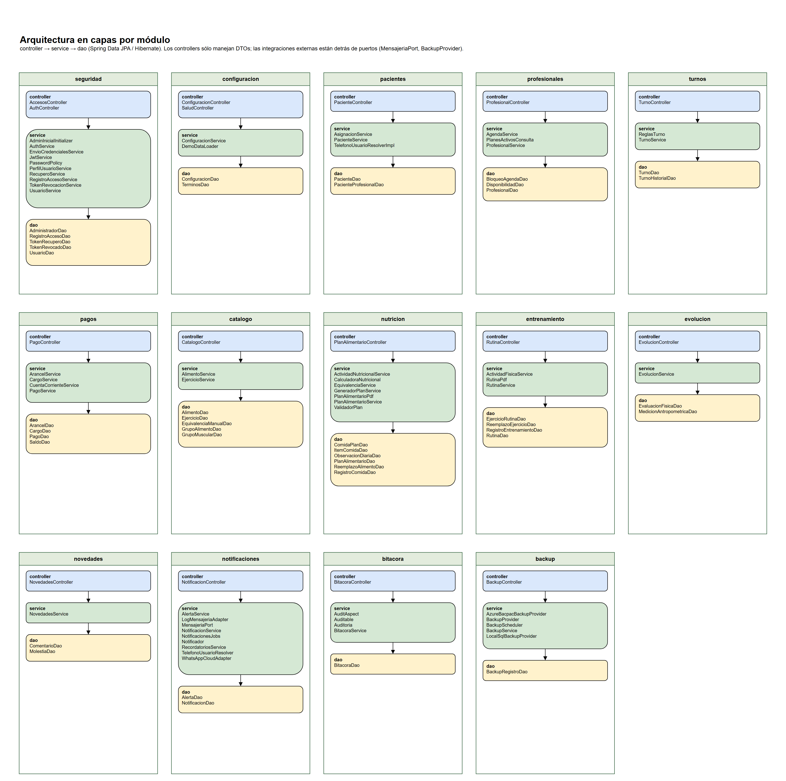
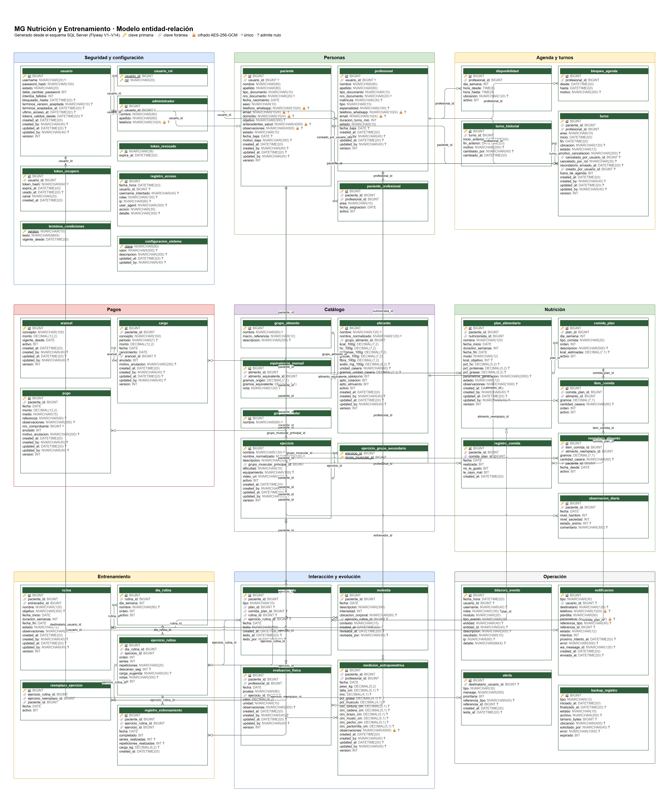
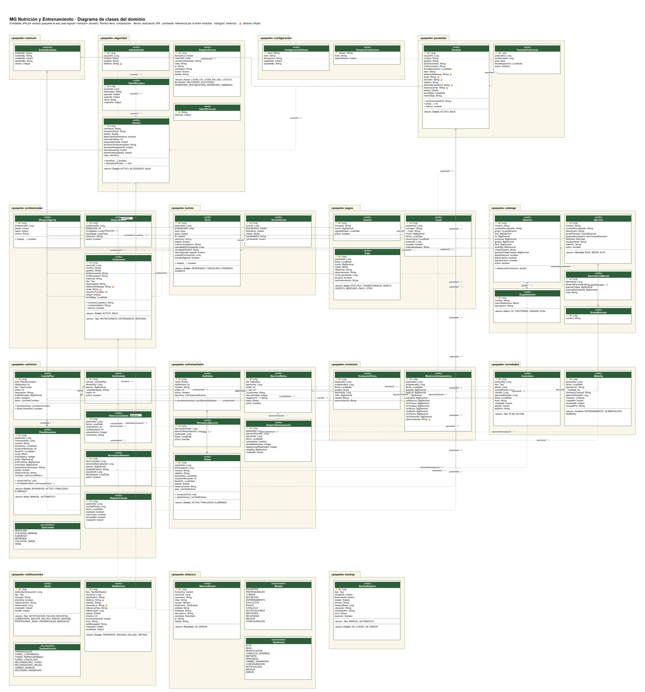

# Visión general

MG Nutrición y Entrenamiento es una aplicación web con un **backend** Spring Boot que expone una API REST (`/api/v1`)
y un **frontend** estático (HTML, CSS y JavaScript con módulos ES, sin framework) que la consume. Los datos viven en
**SQL Server** (Azure SQL Database en la nube). Las notificaciones salen por **WhatsApp Cloud API** y los backups se
exportan a **Azure Blob Storage**.

| Componente | Tecnología |
|---|---|
| Backend | Java 17 · Spring Boot 3.3 · Spring Security (JWT) · Hibernate/JPA con DAOs Spring Data · Flyway |
| Documentos | OpenPDF + JFreeChart (PDF), Apache POI (Excel) |
| Frontend | HTML + CSS + JavaScript (módulos ES) · Chart.js |
| Base de datos | SQL Server 2022 / Azure SQL Database |
| Nube | Azure App Service (Linux), SQL Database, Blob Storage, Application Insights |
| Integraciones | WhatsApp Cloud API (Meta) |
| Pruebas | JUnit 5, Mockito, Testcontainers, ArchUnit, Postman/Newman, Playwright, k6 |

El código fuente está en <https://github.com/LucasDNB/mgnutri-2025>. Las decisiones de diseño están registradas en
`docs/01-decisiones.md` y la trazabilidad casos de uso → requisitos → pruebas en `docs/05-trazabilidad.md`.

# Arquitectura

## Vista de despliegue

```
 Navegador (PC / tablet / celular)          Azure App Service (Linux)
 HTML + CSS + JS servido     ─ HTTPS/JSON ─▶  Spring Boot 3 · Java 17
 por el mismo App Service    ◀─ Bearer JWT ─  /api/v1/** · jobs
                                               │ JDBC         │ HTTPS
                                               ▼              ▼
                                       Azure SQL Database   WhatsApp
                                               │            Cloud API
                                               │ export BACPAC
                                               ▼
                                       Azure Blob Storage (backups)
```

Entornos: **local** (SQL Server en Docker, WhatsApp simulado en el log, backup local), **dev** y **prod** en Azure.

## Capas del backend

El backend está organizado por módulo de negocio (paquete `ar.edu.usal.mgnutri.<módulo>`) y cada módulo en capas
`controller → service → dao`. Una prueba de ArchUnit impide que un controller acceda a un DAO o exponga entidades.

| Capa | Responsabilidad |
|---|---|
| `controller` | HTTP, validación sintáctica (`@Valid`), códigos de estado, autorización por rol (`@PreAuthorize`). Sólo maneja DTOs. |
| `service` | Reglas de negocio, transacciones, autorización por pertenencia (un profesional sólo edita a sus pacientes), auditoría (`@Auditable`). |
| `dao` | Interfaces Spring Data JPA; consultas con `@Query`. Sin reglas. |
| `domain` | Entidades JPA y enums. |
| `dto` | Records de entrada y salida. |

Módulos: `seguridad`, `bitacora`, `pacientes`, `profesionales`, `turnos`, `catalogo`, `nutricion`, `entrenamiento`,
`evolucion`, `pagos`, `notificaciones`, `novedades`, `reportes`, `backup`, `configuracion`, más `common` y `config`.

{.diagrama}

Componentes transversales:

- **Manejo de errores**: `GlobalExceptionHandler` responde *Problem Details* (RFC 7807) con un `code` estable que el
  frontend traduce a mensajes (`docs/04-convenciones-api.md`).
- **Bitácora**: el aspecto `AuditAspect` intercepta los métodos `@Auditable` y registra el evento en `bitacora_evento`
  en una transacción independiente (se registran también los errores). Triggers de base impiden modificarla o borrarla.
- **Cifrado**: `CryptoConverter` (AES-256-GCM) cifra en la base el teléfono, email, domicilio, antecedentes y
  observaciones de pacientes y profesionales.
- **Outbox de notificaciones**: los mensajes se encolan en la tabla `notificacion` dentro de la misma transacción del
  evento y un job los despacha con reintentos. Las integraciones externas están detrás de puertos (`MensajeriaPort`,
  `BackupProvider`) con adaptadores reales y locales.
- **Reloj inyectable** (`Clock`): permite probar las reglas de 24 h y 7 días y los jobs con fechas fijas.

## Seguridad

- Autenticación stateless con **JWT** (8 horas). El cierre de sesión revoca el token (`token_revocado`).
- Contraseñas con BCrypt. Bloqueo de 15 minutos tras 5 intentos fallidos. Recupero por enlace de un solo uso (24 h).
- Un usuario que debe cambiar la contraseña o aceptar nuevos términos sólo accede a esas pantallas (HTTP 428).
- Límite de solicitudes a `/auth/**` por IP y por minuto (`RATE_LIMIT_AUTH`, 10 por defecto).
- Todos los ingresos, salidas e intentos fallidos se guardan en `registro_acceso` (RF-16).
- El token vive en `sessionStorage`: se borra al cerrar la pestaña.
- El backend agrega CSP, HSTS, `X-Frame-Options` y `Referrer-Policy` a todas las respuestas, incluidas las páginas (`SecurityConfig`).

Matriz de permisos resumida (el profesional integral tiene la unión de nutricionista y entrenador):

| Recurso / acción | Admin | Nutricionista | Entrenador | Paciente |
|---|---|---|---|---|
| Pacientes, profesionales, asignaciones | ✔ | — | — | — |
| Agenda | ✔ todas | ✔ propia | ✔ propia | — |
| Turnos | ✔ todos | ✔ propios | ✔ propios | ✔ propios |
| Planes alimentarios | lectura | ✔ asignados | — | ver y descargar el propio |
| Rutinas | lectura | — | ✔ asignados | ver y descargar la propia |
| Antropometría / evaluación física | lectura | ✔ / lectura | lectura / ✔ | ver propias |
| Registros, comentarios, molestias | lectura | ver asignados | ver asignados | ✔ propios |
| Catálogo de alimentos / ejercicios | ✔ / ✔ | ✔ / lectura | lectura / ✔ | — |
| Pagos, cargos, aranceles | ✔ | — | — | ver saldo propio |
| Reportes | ✔ todos | sus pacientes (sin pagos) | sus pacientes (sin pagos) | — |
| Bitácora, accesos, backups, configuración | ✔ | — | — | — |

## Frontend

- Una página HTML por pantalla (`frontend/admin`, `profesional`, `paciente`, `comun`), cada una carga su módulo
  `js/pages/<pagina>.js`. No requiere compilación.
- `js/core/api.js`: cliente HTTP que agrega el token, traduce *Problem Details* y redirige ante 401 y 428.
- `js/core/ui.js`: componentes (campos con ayuda contextual, tablas, modales, avisos). `js/components`: calendario,
  selector de horarios y gráficos (Chart.js).
- `js/config.js`: URL del backend. En Azure la reemplaza el workflow de despliegue.
- Diseño *mobile first*: menú desplegable en celulares y tablas con desplazamiento horizontal.

# Modelo de datos

El esquema se crea y versiona con **Flyway** (`backend/src/main/resources/db/migration`, V1 a V14). Hibernate sólo
valida el esquema (`ddl-auto: validate`). El detalle de cada tabla está en `docs/03-modelo-de-datos.md` y los diagramas
editables en `docs/diagramas` (`er.drawio`, `clases.drawio`), que se regeneran desde la base y el código con
`docs/diagramas/generar_diagramas.py`.

| Migración | Contenido |
|---|---|
| V1 | Usuarios, roles, tokens revocados, configuración, términos y condiciones |
| V2 | Bitácora y registro de accesos (con triggers que impiden modificarlos) y rol `mgnutri_app` |
| V3 | Pacientes, profesionales, administradores y asignaciones |
| V4 | Disponibilidad, bloqueos de agenda, turnos e historial |
| V5 | Notificaciones (outbox) y alertas |
| V6 | Catálogo: grupos de alimentos, alimentos, equivalencias, grupos musculares, ejercicios |
| V7–V8 | Planes alimentarios (comidas e ítems) y rutinas (días y ejercicios) |
| V9 | Mediciones antropométricas y evaluaciones físicas |
| V10 | Aranceles, cargos, pagos, numeración de comprobantes y vista de saldos |
| V11 | Reemplazos, registros de comidas y entrenamiento, observaciones, comentarios y molestias |
| V12 | Datos iniciales del catálogo (163 alimentos, 88 ejercicios) |
| V13–V14 | Tokens de recupero; registro de backups y su configuración |

Convenciones: claves `BIGINT IDENTITY`, fechas en `DATETIME2` (UTC) y `DATE`, montos `DECIMAL(12,2)`, columnas de
auditoría (`created_at/by`, `updated_at/by`) y `version` para bloqueo optimista en las entidades editables. Las bajas
de pacientes y profesionales son lógicas: el historial se conserva.

En las páginas siguientes van los diagramas en alta resolución (se pueden ampliar en el PDF); para el detalle
conviene abrir los `.drawio` o los PNG de `docs/diagramas/png`.

{.diagrama}

{.diagrama}

# Variables de entorno

Todas están en `.env.example`. En local se cargan desde el entorno; en Azure, como *App Settings* de la Web App.

| Variable | Uso |
|---|---|
| `SPRING_PROFILES_ACTIVE` | `local`, `dev` o `prod`; agregar `demo` para cargar datos de demostración |
| `PORT` | Puerto HTTP (local: 8090) |
| `DB_URL`, `DB_USER`, `DB_PASSWORD` | Conexión de la aplicación (usuario con permisos mínimos) |
| `SPRING_FLYWAY_URL`, `SPRING_FLYWAY_USER`, `SPRING_FLYWAY_PASSWORD` | Conexión de Flyway (propietario del esquema) |
| `JWT_SECRET` | Clave de firma de tokens: `openssl rand -base64 48` |
| `DATA_KEY_BASE64` | Clave AES-256 de los datos cifrados: `openssl rand -base64 32`. **No perderla.** |
| `ADMIN_USERNAME`, `ADMIN_PASSWORD_INICIAL` | Administrador inicial (se exige cambiar la contraseña en el primer ingreso) |
| `FRONTEND_URL` | Origen permitido por CORS |
| `RATE_LIMIT_AUTH` | Solicitudes a `/auth/**` por minuto e IP (10) |
| `WA_ENABLED`, `WA_PHONE_ID`, `WA_TOKEN` | WhatsApp Cloud API |
| `WA_CREDENCIALES_MODO` | `PASSWORD` (envía la contraseña temporal) o `ENLACE` (envía un enlace de activación) |
| `JOBS_ENABLED` | Habilita los jobs programados |
| `BACKUP_PROVIDER` | `local` (BACKUP DATABASE) o `azure` (BACPAC a Blob Storage) |
| `BACKUP_DIR_SERVIDOR`, `BACKUP_DIR_DESCARGA`, `BACKUP_DB_NAME` | Backup local |
| `AZ_*` | Suscripción, grupo de recursos, servidor y base SQL, cuenta y contenedor de Storage (backup en Azure) |
| `FRONTEND_PATH` | Carpeta del frontend si lo sirve el propio backend (local y demo) |
| `SWAGGER_ENABLED` | Publica la documentación OpenAPI en `/swagger-ui.html` |
| `DEMO_PASSWORD`, `DEMO_PACIENTES`, `DEMO_MESES` | Datos demo: contraseña de las cuentas, cantidad de pacientes (30) y meses de historia (6) |

# Instalación local

Requisitos: Java 17, Docker Desktop y Git (Node sólo para las pruebas E2E y Postman).

```bash
git clone https://github.com/LucasDNB/mgnutri-2025.git
cd mgnutri-2025
docker compose up -d                 # SQL Server 2022 en localhost:14333 y base mgnutri
cd backend
./mvnw spring-boot:run               # perfil local; Flyway crea el esquema
```

Abrir <http://localhost:8090> e ingresar como `admin` con la contraseña temporal `Admin2025!` (se pide cambiarla).
Para tener datos de ejemplo usar `SPRING_PROFILES_ACTIVE=local,demo` sobre una base vacía: crea 5 profesionales
(`20111111`, `20222222`, `20333333`, `20444444`, `20555555`) y 30 pacientes (usuario `40000000` y siguientes), todos con
la contraseña `Demo2025!`.

# Despliegue en Azure

## Recursos

| Recurso | Nombre sugerido | Configuración |
|---|---|---|
| Resource Group | `rg-mgnutri` | Región permitida por la suscripción (Azure for Students: Chile Central) |
| Azure SQL Server + DB | `sql-mgnutri` / `mgnutri` | Basic o serverless; firewall: servicios de Azure + IP de administración |
| App Service Plan | `asp-mgnutri` | Linux **B1** con *Always On* (necesario para los jobs) |
| Web App | `app-mgnutri` | Java 17 SE; *health check* `/api/v1/salud`; sirve la API y el frontend |
| Storage Account | `stmgnutri` | Contenedor privado `backups` |
| Application Insights | `appi-mgnutri` | Prueba de disponibilidad sobre `/api/v1/salud` cada 5 min y alerta por mail (ver [Monitoreo](#monitoreo)) |

## Base de datos

1. Crear la base `mgnutri`.
2. Crear el usuario de **migración** (propietario del esquema) y el de **aplicación** con permisos mínimos:

```sql
CREATE USER mgnutri_migracion WITH PASSWORD = '<secreto>';
ALTER ROLE db_owner ADD MEMBER mgnutri_migracion;
CREATE USER mgnutri_app_user WITH PASSWORD = '<secreto>';
-- La migración V2 crea el rol si no existe y le da los permisos (incluye DENY UPDATE/DELETE sobre bitácora y accesos)
CREATE ROLE mgnutri_app;
ALTER ROLE mgnutri_app ADD MEMBER mgnutri_app_user;
```

3. Flyway aplica las migraciones al arrancar con `SPRING_FLYWAY_*` (usuario de migración); la aplicación usa `DB_*`
   (usuario de aplicación).

## Backend (App Service)

1. Cargar las *App Settings* (sección [Variables de entorno](#variables-de-entorno)). Mínimas: `SPRING_PROFILES_ACTIVE=prod`,
   `DB_*`, `SPRING_FLYWAY_*`, `JWT_SECRET`, `DATA_KEY_BASE64`, `ADMIN_PASSWORD_INICIAL`, `FRONTEND_URL`, `WA_*`,
   `BACKUP_PROVIDER=azure` y `AZ_*`.
2. Para el backup en Azure, habilitar la identidad administrada de la Web App y darle el rol *SQL DB Contributor* sobre
   el servidor SQL (la exportación BACPAC se pide por la API de Azure Resource Manager). El acceso al contenedor de
   Storage usa la clave de la cuenta (`AZ_STORAGE_KEY`).
3. Publicar `mgnutri.jar` (lo hace el pipeline) y verificar `GET /api/v1/salud` → `{"estado":"OK","bd":"OK"}`.
4. En *Opciones avanzadas › Configuración*, cargar `centro.url_sistema` con la URL del sistema (se usa en los mensajes).

## Frontend

- Maven copia la carpeta `frontend/` dentro del jar (`classpath:/static`) y Spring Boot la sirve en el mismo dominio
  que la API: no hace falta CORS ni configurar la URL del backend (`config.js` usa rutas relativas).
- En local, `FRONTEND_PATH` sirve los archivos desde disco para ver los cambios sin recompilar.
- Alternativa: publicar `frontend/` en Azure Static Web Apps (workflow `frontend.yml`, secretos
  `AZURE_STATIC_WEB_APPS_API_TOKEN` y `API_BASE_URL`, cabeceras en `staticwebapp.config.json`). Se descartó en la
  instalación actual porque la suscripción Azure for Students no permite Static Web Apps en sus regiones.

## CI/CD (GitHub Actions)

| Workflow | Disparador | Pasos |
|---|---|---|
| `backend.yml` | push / PR a `main` en `backend/**` o `frontend/**`, o manual | `mvn verify` (unitarias, ArchUnit, Testcontainers) → API levantada + Newman → deploy a App Service si existe el secreto `AZURE_WEBAPP_PUBLISH_PROFILE` |
| `frontend.yml` | push a `main` en `frontend/**` | verificación de sintaxis JS → deploy a Static Web Apps sólo si existe `AZURE_STATIC_WEB_APPS_API_TOKEN` (alternativa) |

Cada entrega se etiqueta `vX.Y.Z` (RNF 3.5). Mientras no estén cargados los secretos, los pasos de despliegue se omiten.

## WhatsApp Cloud API

1. Crear la app en Meta for Developers, agregar el producto WhatsApp y un número verificado.
2. Generar un token permanente de usuario del sistema (`WA_TOKEN`) y tomar el *phone number id* (`WA_PHONE_ID`).
3. Enviar a aprobación las plantillas de la spec 11 (categoría *Utility*, idioma `es_AR`): `mg_credenciales`,
   `mg_recupero_password`, `mg_turno_confirmado`, `mg_turno_reprogramado`, `mg_turno_cancelado`,
   `mg_recordatorio_turno`, `mg_recordatorio_deuda` y `mg_cambio_arancel`.
4. Si Meta rechaza la plantilla de credenciales con contraseña, usar `WA_CREDENCIALES_MODO=ENLACE`.
5. Con `WA_ENABLED=false` los mensajes se registran en el log como enviados (`LOCAL-…`) y el administrador recibe una
   alerta para entregar las credenciales por otro medio.

# Operación

## Jobs programados

Zona horaria America/Argentina/Buenos_Aires.

| Job | Programación |
|---|---|
| Despacho de notificaciones (outbox, con reintentos) | cada minuto |
| Recordatorio de turnos del día siguiente | `turnos.recordatorio_hora` (09:00) |
| Recordatorio de deuda | `pagos.recordatorio_cron` (sábados 10:00) |
| Finalizar planes y rutinas vencidos | 00:30 |
| Limpieza de tokens vencidos | 03:00 |
| Backup automático | configurable en *Backups* |

Se pueden ejecutar a mano desde *Opciones avanzadas › Notificaciones* o con `POST /api/v1/admin/jobs/{job}/ejecutar`.
Si el plan de App Service no tiene *Always On*, programar un cron externo que invoque esos endpoints.

## Backup y restauración

Objetivo: tiempo de recuperación de 2 horas o menos (spec 15).

- **Automático de Azure SQL**: restauración a un punto en el tiempo (retención de 7 días en Basic); procedimiento (a).
- **BACPAC del sistema**: *Backups › Generar backup* exporta `mgnutri-AAAAMMDD-HHmmss.bacpac` al contenedor `backups`;
  la descarga usa un enlace temporal de 15 minutos. Para restaurar: procedimiento (b).
- **Local (Docker)**: `BACKUP DATABASE` a `/var/opt/mssql/backup`; restaurar con
  `RESTORE DATABASE mgnutri FROM DISK = '/var/opt/mssql/backup/<archivo>.bak' WITH REPLACE`.
- Los backups programados se borran automáticamente al vencer la retención configurada. Un backup fallido genera una
  alerta para el administrador.

### Procedimiento (a): restauración a un punto en el tiempo

1. Portal: *SQL database `mgnutri` › Restore* (o `az sql db restore -g rg-mgnutri -s <servidor> -n mgnutri
   --dest-name mgnutri-restaurada --time <AAAA-MM-DDTHH:MM:SSZ> --edition Basic`). La hora es UTC; el punto más reciente
   disponible suele estar entre 5 y 10 minutos atrás.
2. La base nueva es una copia física: conserva usuarios, contraseñas y permisos.
3. En la Web App cambiar `DB_URL` y `SPRING_FLYWAY_URL` a `databaseName=mgnutri-restaurada` (la Web App se reinicia sola).
4. Verificar `GET /api/v1/salud` → `"bd":"OK"` y un dato conocido.

### Procedimiento (b): importar un BACPAC

1. Crear una base vacía: `az sql db create -g rg-mgnutri -s <servidor> -n mgnutri-restaurada --edition Basic`.
2. Importar: portal *SQL database › Import* o `az sql db import ... -n mgnutri-restaurada --storage-uri
   https://<cuenta>.blob.core.windows.net/backups/<archivo>.bacpac --storage-key-type StorageAccessKey --storage-key <clave>
   -u <admin> -p <contraseña>`.
3. **Restablecer las contraseñas de los usuarios de la base**: el BACPAC conserva los usuarios y sus roles, pero la
   importación les asigna contraseñas al azar. Sin este paso Flyway falla con *Login failed for user
   'mgnutri_migracion'* y la aplicación no arranca:

```sql
ALTER USER mgnutri_migracion WITH PASSWORD = '<SPRING_FLYWAY_PASSWORD>';
ALTER USER mgnutri_app_user  WITH PASSWORD = '<DB_PASSWORD>';
```

4. Cambiar `DB_URL` y `SPRING_FLYWAY_URL` como en (a) y verificar la salud.

### Ensayo del 19/11/2026 (CA-15.3.1)

Se cargó un dato testigo en `configuracion_sistema`, se lo borró (incidente simulado) y se lo recuperó por los dos caminos.

| Paso | Duración |
|---|---|
| (a) Restauración a un punto en el tiempo (02:55:30 UTC, antes del borrado) | 4 min 42 s |
| (a) Cambio de cadena de conexión hasta salud OK con conexiones en la base restaurada | 2 min 52 s |
| (b) Exportación BACPAC (43 KB) | 5 min 22 s |
| (b) Creación de la base + importación | 6 min 29 s |
| (b) Restablecer contraseñas + reinicio hasta salud OK | 2 min 17 s |
| **Total (a)** | **≈ 8 min** |
| **Total (b)** | **≈ 15 min** (sin contar el diagnóstico) |

Resultado: en ambos casos se recuperó el testigo, las 14 migraciones, el catálogo (163 alimentos) y los usuarios;
la aplicación funcionó contra la base restaurada y luego se volvió a la original. Objetivo de ≤ 2 h: **cumplido**.

Hallazgo: en el camino (b) la aplicación no arrancó hasta restablecer las contraseñas (paso 3, agregado al
procedimiento). Esa caída de ~14 minutos disparó la alerta `mgnutri-caido` (03:31 UTC) y se resolvió sola al
recuperarse (03:36 UTC), lo que verificó también el monitoreo de punta a punta.

## Rotación de secretos

- `JWT_SECRET`: cambiarlo invalida todas las sesiones (los usuarios vuelven a ingresar).
- `WA_TOKEN`, claves de Storage y contraseñas de la base: rotar en *App Settings* y reiniciar la Web App.
- `DATA_KEY_BASE64`: **no rotar** sin un proceso de re-cifrado; los datos cifrados quedarían ilegibles. Guardarla en
  Key Vault y en un resguardo fuera de Azure.

## Monitoreo

- `GET /api/v1/salud` informa el estado de la aplicación y de la base.
- Application Insights con prueba de disponibilidad cada 5 minutos y alerta por mail (RNF 3.2).
- *Opciones avanzadas › Notificaciones* muestra los mensajes fallidos; *Bitácora* los errores de negocio y de sistema.

Recursos (grupo `rg-mgnutri`):

| Recurso | Nombre | Configuración |
|---|---|---|
| Log Analytics | `log-mgnutri` | Retención 30 días, tope diario 0,2 GB |
| Application Insights | `appi-mgnutri` | Basado en el workspace; el backend envía telemetría con el agente Java de App Service (`APPLICATIONINSIGHTS_CONNECTION_STRING`, `ApplicationInsightsAgent_EXTENSION_VERSION=~3`), sin cambios de código |
| Prueba estándar | `salud-mgnutri` | `GET /api/v1/salud` cada 5 min desde São Paulo y Texas; exige HTTP 200 (la salud responde 503 si la base no conecta), reintento y certificado TLS con ≥ 7 días de vigencia |
| Grupo de acción | `ag-mgnutri` | Mail al administrador del sistema |
| Alerta de métrica | `mgnutri-caido` | Severidad 1; se dispara si la prueba falla en las 2 ubicaciones dentro de 5 min y se resuelve sola al recuperarse |

- El porcentaje mensual de disponibilidad (evidencia del 99 % del RNF 3.2) se ve en *appi-mgnutri › Disponibilidad*.
- Costo: cada ejecución de la prueba cuesta ~USD 0,0007, unos USD 6 por mes por ubicación (~USD 12 con dos).
- La CLI no admite el criterio `WebtestLocationAvailabilityCriteria`: la alerta se crea con `az rest` (PUT a
  `Microsoft.Insights/metricAlerts`, api-version 2018-03-01) o desde el portal (*Disponibilidad › prueba › Abrir reglas*).

## Mantenimiento programado

Cargar el aviso en `mantenimiento.mensaje` (*Opciones avanzadas › Configuración*): se muestra como banner en todas las
pantallas. Dejarlo vacío para ocultarlo. Los despliegues de producción se hacen en horario de bajo uso.

# Pruebas

| Nivel | Herramienta | Dónde | Cómo ejecutarlas |
|---|---|---|---|
| Unitarias | JUnit 5 + Mockito, reloj fijo | `backend/src/test` | `./mvnw test` |
| Arquitectura | ArchUnit (capas, entidades no expuestas) | `backend/src/test` | `./mvnw test` |
| Integración | Spring Boot Test + Testcontainers (SQL Server real) | `backend/src/test` | `./mvnw verify` (requiere Docker) |
| API | Postman + Newman, un caso por criterio de aceptación | `postman/` | en CI, o `npx newman run postman/mgnutri.postman_collection.json -e postman/local.postman_environment.json` |
| E2E | Playwright: 8 guiones de la spec 16 en Chrome de escritorio y Chrome Android | `pruebas/e2e` | `npm install` y `E2E_URL=<url> npx playwright test` contra una instancia con **base propia** (el primer ingreso cambia la contraseña del admin) |
| Rendimiento | k6: 50 usuarios, 500 pacientes / 1 año | `pruebas/rendimiento` | ver `pruebas/rendimiento/README.md` |

Resultados de la última corrida: 16/16 guiones E2E aprobados (escritorio y Android) y p90 máximo de 541 ms en la prueba
de rendimiento (criterio: menos de 5 s). La evidencia por caso de uso está en `docs/05-trazabilidad.md`.

# Estructura del repositorio

```
mgnutri-2025/
├── backend/            Spring Boot: código por módulo, migraciones Flyway, pruebas
├── frontend/           Páginas por rol, css/, js/ (core, components, pages), assets/
├── docs/               Decisiones, arquitectura, modelo de datos, API, trazabilidad, diagramas y manuales
├── specs/              Especificaciones por paquete de trabajo (spec-kit)
├── postman/            Colección y entornos de pruebas de API
├── pruebas/            E2E (Playwright) y rendimiento (k6)
├── .github/workflows/  backend.yml y frontend.yml
├── docker-compose.yml  SQL Server local
└── .env.example        Variables de entorno
```
