# Introducción

El sistema de **MG Nutrición y Entrenamiento** reúne en un solo lugar los turnos, los planes alimentarios, las rutinas de
entrenamiento, la evolución de cada paciente y su cuenta corriente. Se usa desde el navegador, sin instalar nada, tanto en
la computadora como en el celular.

Este manual tiene un capítulo por cada tipo de usuario:

| Usuario | Qué hace en el sistema | Capítulo |
|---|---|---|
| Paciente | Consulta su plan y su rutina, registra lo que hizo, pide y modifica turnos, ve su evolución y su cuenta | [3](#paciente) |
| Nutricionista | Arma planes alimentarios (a mano o automáticos), carga mediciones y sigue a sus pacientes | [4](#nutricionista) |
| Entrenador | Arma rutinas, carga evaluaciones físicas y atiende molestias | [5](#entrenador) |
| Profesional integral | Hace las tareas del nutricionista y del entrenador con los mismos pacientes | [6](#profesional-integral) |
| Administrador | Gestiona pacientes, profesionales, turnos, pagos, reportes y la configuración | [7](#administrador) |

**Requisitos:** un navegador actualizado (Chrome, Edge, Safari o Firefox) y conexión a internet. Por seguridad, la sesión
dura 8 horas y se cierra al cerrar la pestaña del navegador.

**Ayuda en pantalla:** los campos con el ícono **?** muestran una explicación al tocarlos o al pasar el mouse.

# Acceso al sistema

## Ingresar

1. Abrí la dirección del sistema que te dio el centro.
2. En **Usuario** escribí tu número de documento, sin puntos.
3. Escribí tu contraseña y tocá **INGRESAR**.

Cada usuario entra directamente a su pantalla de inicio. Si te equivocás de contraseña varias veces seguidas, la cuenta se
bloquea 15 minutos por seguridad (ver [Preguntas frecuentes](#preguntas-frecuentes-y-errores-comunes)).

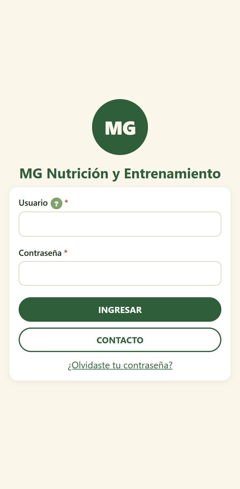{.celular}

## Primer ingreso

Cuando el centro te da de alta recibís por WhatsApp tu usuario y una **contraseña temporal**. La primera vez que ingresás:

1. El sistema te pide reemplazar la contraseña temporal. Escribí la temporal, una nueva y repetila. La nueva debe tener
   al menos 8 caracteres, con letras y números, y no puede contener tu documento.
2. Leé los **términos y condiciones** y la política de privacidad, marcá *Leí y acepto…* y tocá **Continuar**.

Si los términos se actualizan más adelante, el sistema te los vuelve a mostrar al ingresar.

## Recuperar la contraseña

1. En la pantalla de ingreso tocá **¿Olvidaste tu contraseña?**
2. Escribí tu documento (o tu teléfono) y tocá **Enviar enlace**. Te llega un enlace por WhatsApp al número registrado.
3. Abrí el enlace, escribí la nueva contraseña y tocá **Guardar contraseña**.

El enlace vence a las 24 horas y sirve una sola vez. Si venció, pedí uno nuevo.

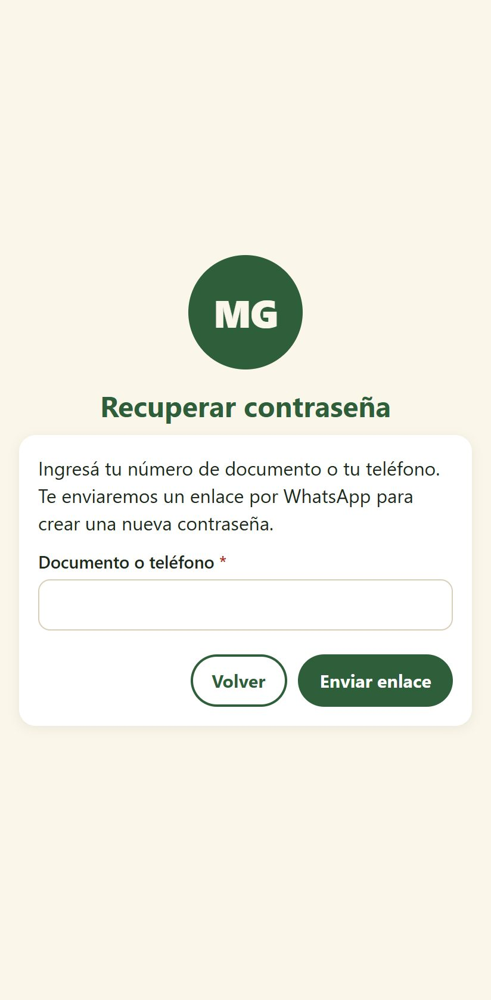{.celular}

## Contacto con el centro

El botón **CONTACTO** (en la pantalla de ingreso y en el inicio del paciente) muestra la dirección, los horarios y el
teléfono del centro, con un botón para **Escribir por WhatsApp**, aun sin haber ingresado.

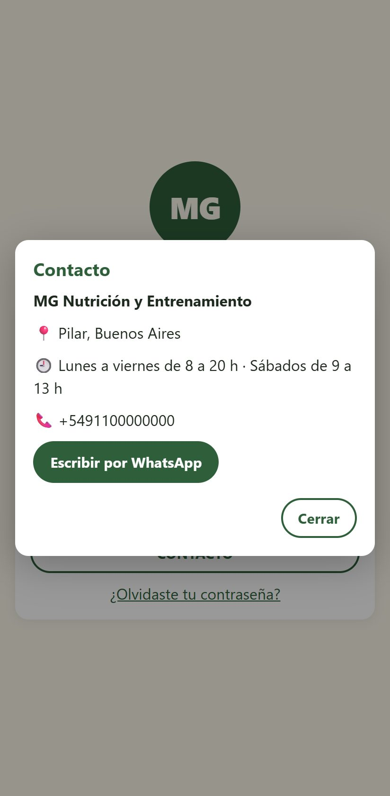{.celular}

## Moverse por el sistema y salir

- En la computadora, el menú está siempre visible debajo del encabezado.
- En el celular, el menú se abre con el botón **☰** (arriba a la izquierda).
- Para salir tocá **Salir** o **Cerrar sesión**. Usá **Cambiar contraseña** cuando quieras renovarla.

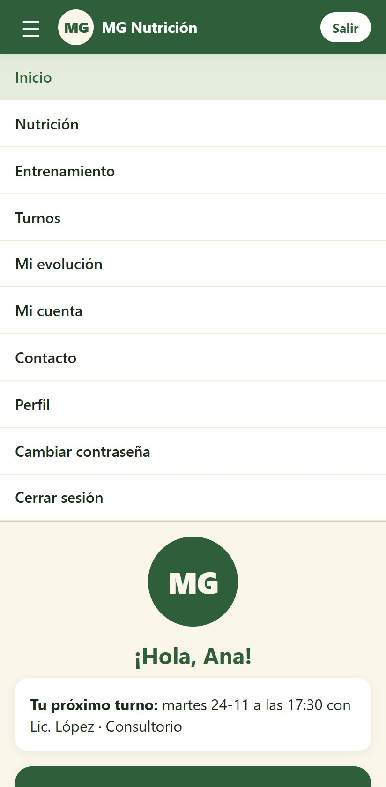{.celular}

# Paciente

El sistema está pensado para que lo uses desde el celular. Las pantallas de esta sección son las del teléfono; en la
computadora se ven igual pero más anchas (el plan semanal, por ejemplo, se muestra como grilla).

## Inicio

Muestra tu próximo turno y los accesos a **Nutrición**, **Entrenamiento** y **Contacto**, más los atajos a turnos,
evolución, cuenta y perfil.

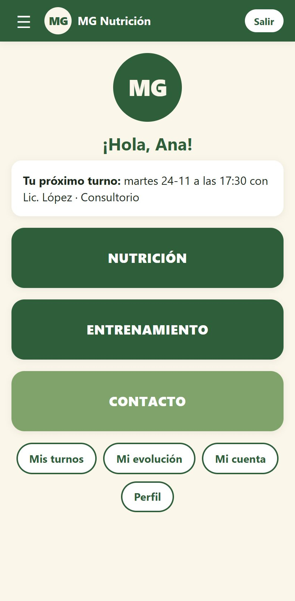{.celular}

## Nutrición

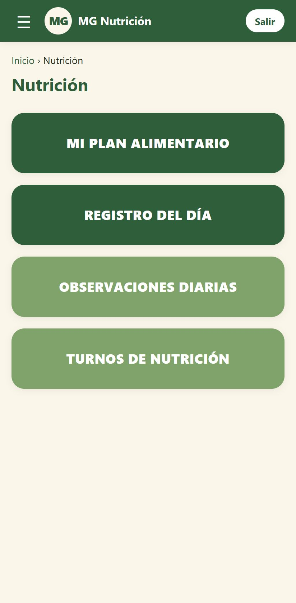{.celular}

### Mi plan alimentario

Muestra el plan vigente que armó tu nutricionista, día por día. Tocá las pestañas **Lun … Dom** para cambiar de día.
Cada comida indica los alimentos con su cantidad en gramos y en medida casera (por ejemplo, *≈ 1 taza*).

- **Descargar PDF**: baja el plan completo para imprimirlo o guardarlo.
- **Comentar sobre el plan** o **Comentar esta comida**: le envía un mensaje a tu nutricionista (hasta 300 caracteres).

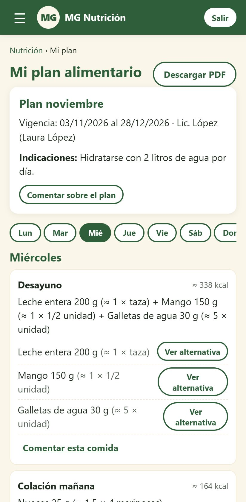{.celular}

### Reemplazar un alimento

Si no tenés un alimento o no te gusta, tocá **Ver alternativa** al lado. El sistema propone equivalentes del mismo grupo
con la cantidad ya ajustada (las indicadas por tu nutricionista aparecen primero). Elegí una y el plan se actualiza; el
alimento reemplazado se marca y podés **Volver al original** cuando quieras. Tu nutricionista ve los reemplazos que hiciste.

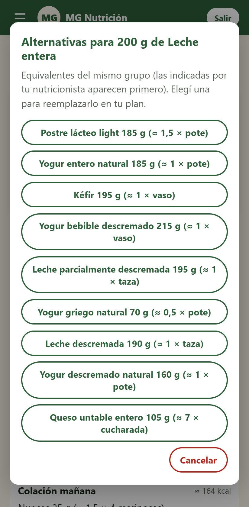{.celular}

### Marcar las comidas

Los días del plan se eligen arriba (dos filas). Cada comida tiene:

- **Completada**: queda registrada como *La hice como estaba propuesta*; si reemplazaste algún alimento de esa comida,
  como *La hice con cambios*.
- **Saltada / reemplazada**: queda registrada como *No completada*.
- **No me gustó** y **Me cayó mal**.

Tocar de nuevo un botón marcado lo desmarca. Se pueden marcar las comidas de hoy, ayer y anteayer.

### Observaciones del día

Al final de cada día del plan, **Observaciones del día** abre una ventana para indicar tu nivel de **hambre** y de
**saciedad** del 1 (nada) al 5 (mucha), opcionalmente tu estado de ánimo y un comentario. Desde la ventana podés ver el
historial con el gráfico de los últimos 30 días.

### Registro del día

Muestra el **cumplimiento de la semana** (comidas hechas como estaban propuestas) y las marcas de hoy, ayer y anteayer,
que también se pueden cambiar desde ahí.

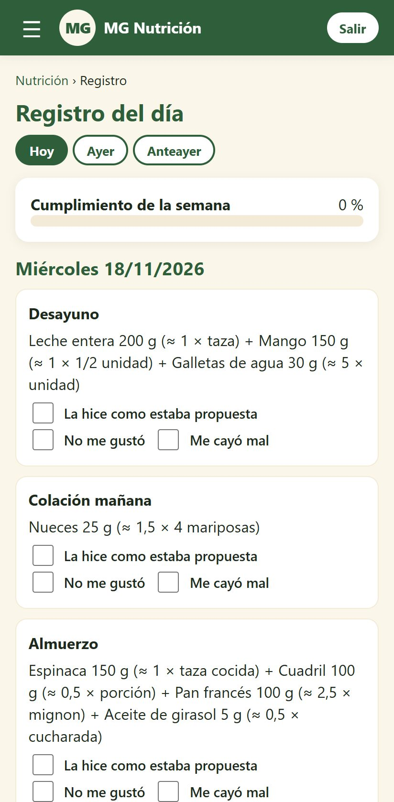{.celular}

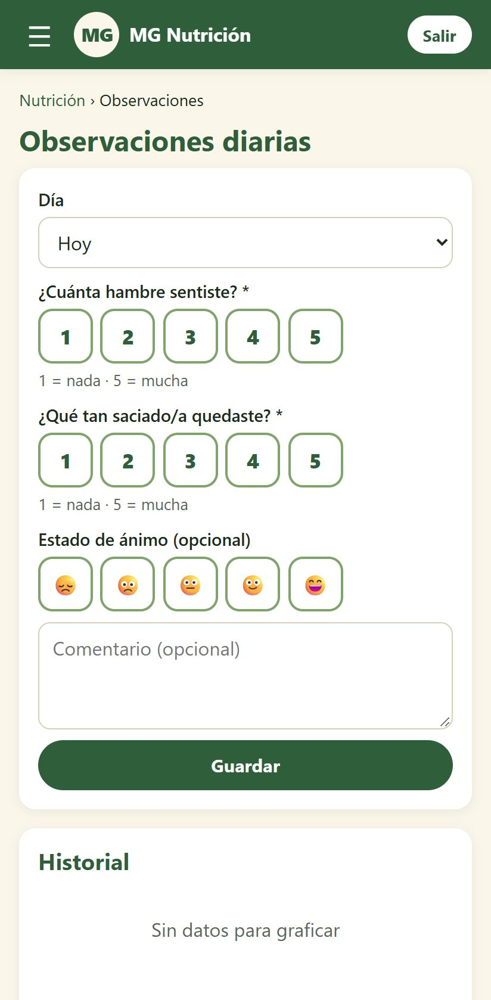{.celular}

## Entrenamiento

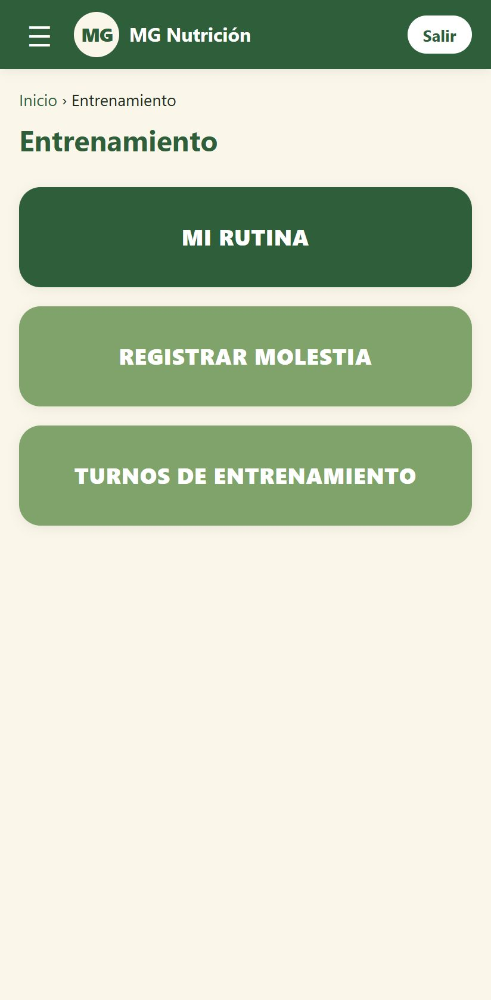{.celular}

### Mi rutina

Muestra los ejercicios de hoy con series, repeticiones, descanso y carga sugerida. Las pestañas **Día**, **Semana** y
**Mes** cambian la vista (en *Mes* se ven los días cumplidos). Si hoy no entrenás, te muestra la próxima sesión.

Para registrar lo que hiciste en cada ejercicio:

1. Marcá la casilla de **completado**.
2. Si querés, anotá los **kg**, las **series** y las **reps** que realizaste. Se guarda solo al salir de cada campo.

Al completar todos los ejercicios aparece *¡Sesión completa!* Podés registrar hoy, ayer o anteayer.

Otras acciones de cada ejercicio:

- **🎬 Ver video**: abre el video de referencia del ejercicio.
- **Pedir variante**: propone ejercicios del mismo grupo muscular manteniendo series y repeticiones. Podés volver al original.
- **Comentar**: mensaje a tu entrenador.
- **Molestia**: para avisar un dolor (ver más abajo).
- **Descargar PDF**: la rutina completa, con enlaces a los videos.

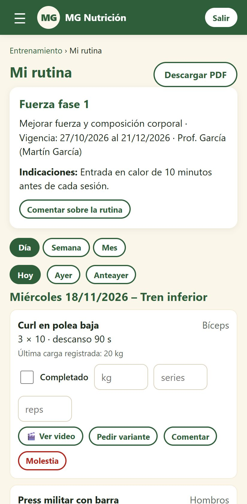{.celular}

### Avisar una molestia

Describí qué sentís, elegí la **intensidad** del 1 al 10, la zona del cuerpo y el contexto, y tocá **Enviar a mi
profesional**. Las molestias de intensidad 7 o más le llegan a tu profesional como **prioritarias**.

> El sistema no realiza diagnósticos. Si el dolor es intenso o persistente, consultá a un médico.

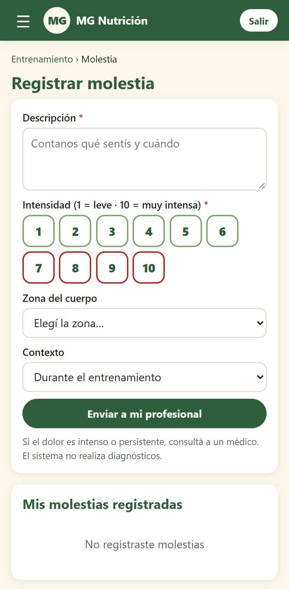{.celular}

## Turnos

**Mis turnos** muestra los próximos y los de los últimos 6 meses con su estado.

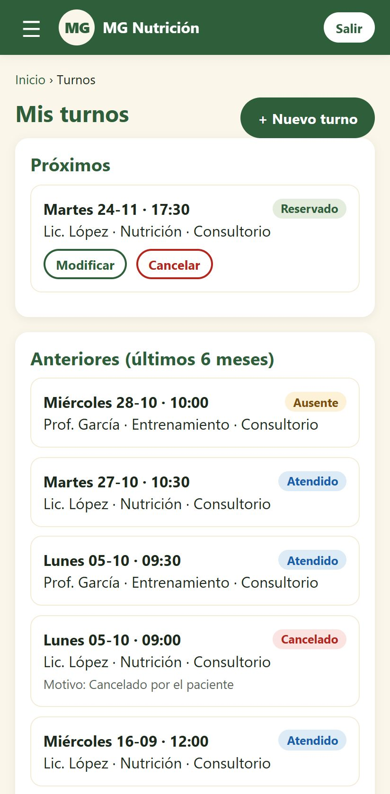{.celular}

### Pedir un turno

1. Tocá **+ Nuevo turno** y elegí el área (**Nutrición** o **Entrenamiento**).
2. Elegí el profesional (el tuyo aparece marcado como *Tu profesional*).
3. Elegí día y hora entre los horarios libres. Con **Semana siguiente ›** ves hasta 30 días hacia adelante.
4. Revisá los datos y tocá **Confirmar turno**. Te llega la confirmación por WhatsApp.

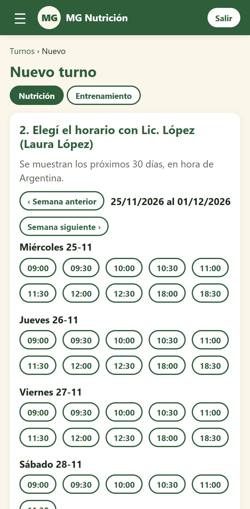{.celular}

**Reglas de turnos**

- Los turnos se piden con al menos 2 horas de anticipación.
- No podés tener dos turnos de la misma área con menos de 7 días de diferencia. Si ya tenés uno cerca, el sistema te
  ofrece modificar el existente.
- Un turno se puede **Modificar** o **Cancelar** hasta 24 horas antes. Con menos tiempo, comunicate con el centro.
- El día anterior recibís un recordatorio por WhatsApp.

## Mi evolución

Gráficos de peso, composición corporal (% grasa y músculo), perímetros, desempeño en las pruebas físicas y cargas
levantadas, más la tabla con las diferencias respecto de la medición anterior y la inicial. **Descargar PDF** baja el
reporte de evolución.

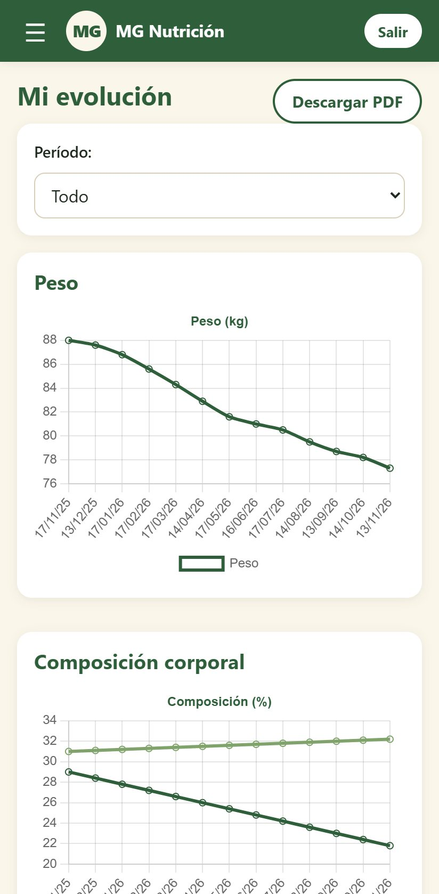{.celular}

## Mi cuenta y perfil

- **Mi cuenta**: tu saldo (al día, deudor o a favor) y los últimos movimientos.
- **Perfil**: tus datos. Podés actualizar el email y el domicilio; para cambiar el resto, comunicate con el centro.

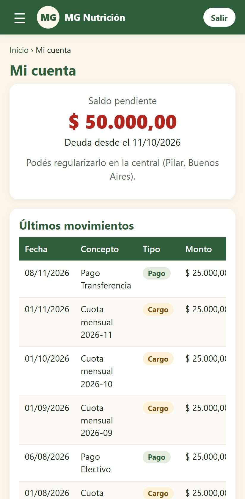{.celular}

# Nutricionista

## Inicio, pacientes y novedades

El inicio muestra los **turnos de hoy** y los accesos a calendario, pacientes, **Novedades** (con la cantidad sin leer),
catálogo y reportes. Si todavía no cargaste tu agenda, te lo recuerda. En **Pacientes** buscás por apellido, nombre o
documento y abrís la **ficha** de cada uno.

**Novedades** reúne los comentarios y las molestias de tus pacientes. Las prioritarias aparecen marcadas en rojo; tocá
**Marcar leída** una vez atendidas.

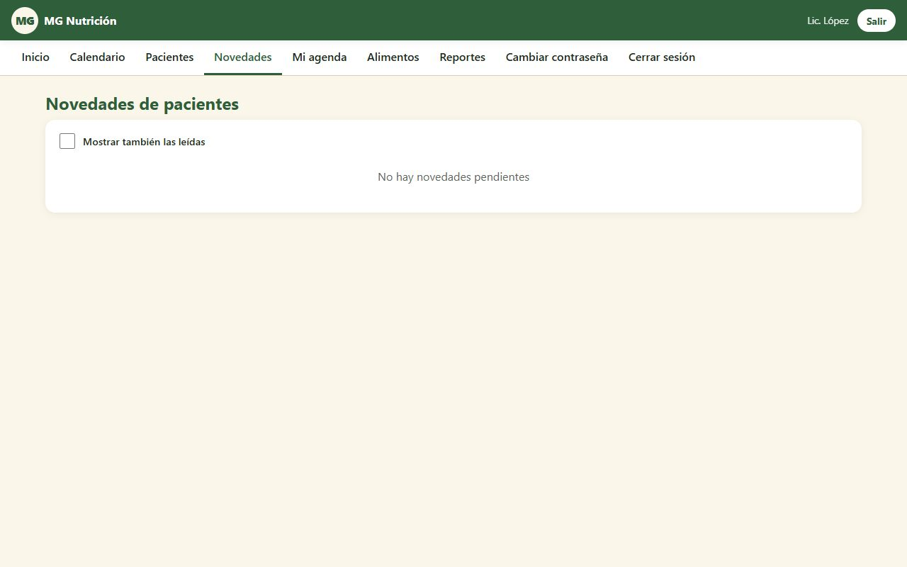

## Ficha del paciente

La ficha tiene pestañas: **Datos**, **Turnos**, **Planes**, **Rutinas**, **Evolución** y **Registros**. Sólo podés
modificar planes y mediciones de los pacientes que tenés asignados en tu área.

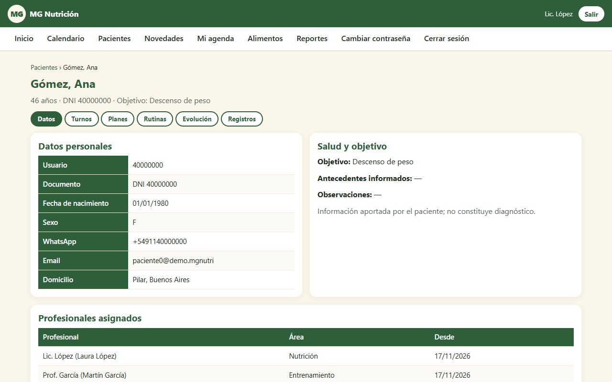

## Planes alimentarios

En la pestaña **Planes** ves el historial de planes del paciente (borrador, activo, finalizado) con las acciones
**Editar**, **Duplicar** y **Eliminar**.

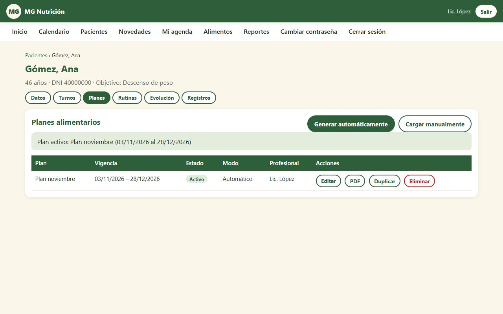

### Crear un plan a mano

1. Tocá **Cargar manualmente**. Completá nombre, fecha de inicio, duración y observaciones generales.
2. Tocá cada celda de la grilla (día × comida) para editarla: escribí la descripción como la verá el paciente y, si
   querés que el sistema calcule kcal y macronutrientes, agregá **ítems estructurados** buscando alimentos del catálogo.
3. Atajos: **+ Tipo de comida** (colaciones), **Copiar a…** (copia una celda a otros días) y **Replicar un día a toda la semana**.
4. **Guardar borrador** para seguir después, o **Confirmar plan** para que el paciente lo vea.

Al confirmar, cada día debe tener al menos 4 comidas con contenido. Si el paciente ya tenía un plan activo, el sistema
pregunta si querés finalizarlo.

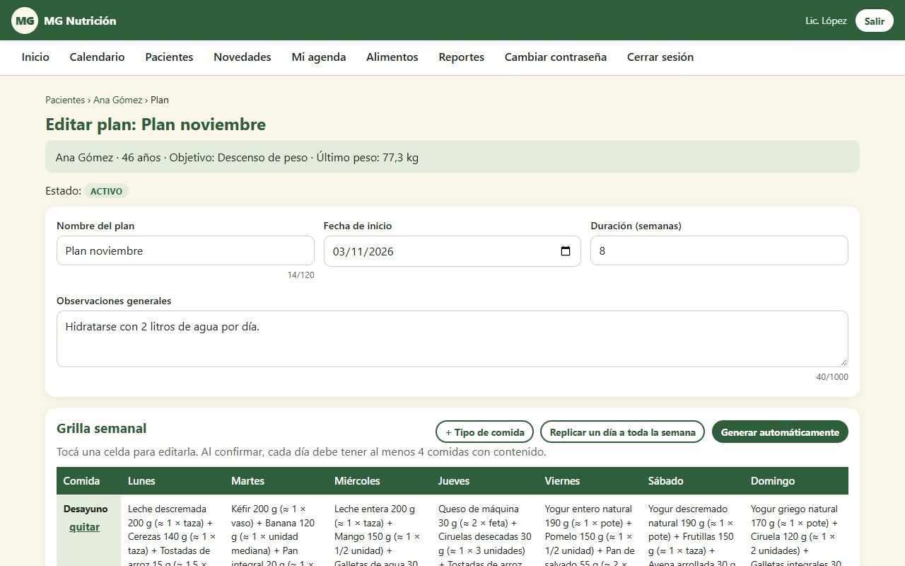

### Generar un plan automáticamente

1. Tocá **Generar automáticamente**.
2. Indicá las **kcal diarias** y el porcentaje de hidratos, proteínas y grasas (deben sumar 100 %).
3. Elegí las comidas (mínimo 4) y cómo se reparten las calorías (deben sumar 100 %), la variedad (menú distinto cada
   día o el mismo toda la semana) y los alimentos a excluir.
4. Tocá **Generar borrador**. Cada celda muestra un indicador de desvío respecto del objetivo (verde, amarillo o rojo).
5. Revisá y ajustá las celdas que quieras, **Regenerar** si buscás otra propuesta, y **Confirmar plan**.

> El sistema propone un borrador: no reemplaza tu criterio profesional.

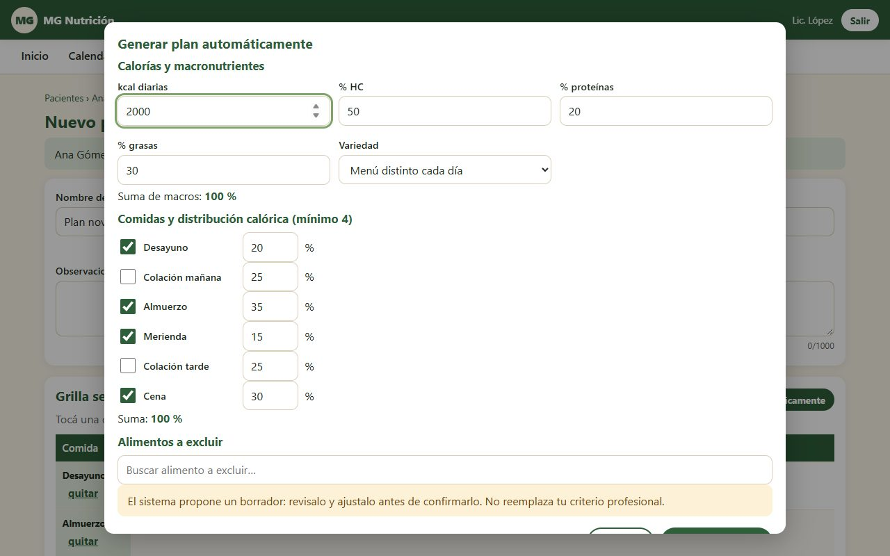

## Antropometría y evolución

En la pestaña **Evolución** tocá **Cargar antropometría**: fecha, peso, talla (si la dejás vacía se usa la última),
% grasa, % músculo y perímetros. El IMC se calcula solo. Si un valor está fuera del rango habitual, el sistema avisa
para que lo revises. Podés editar o eliminar las mediciones que cargaste vos.

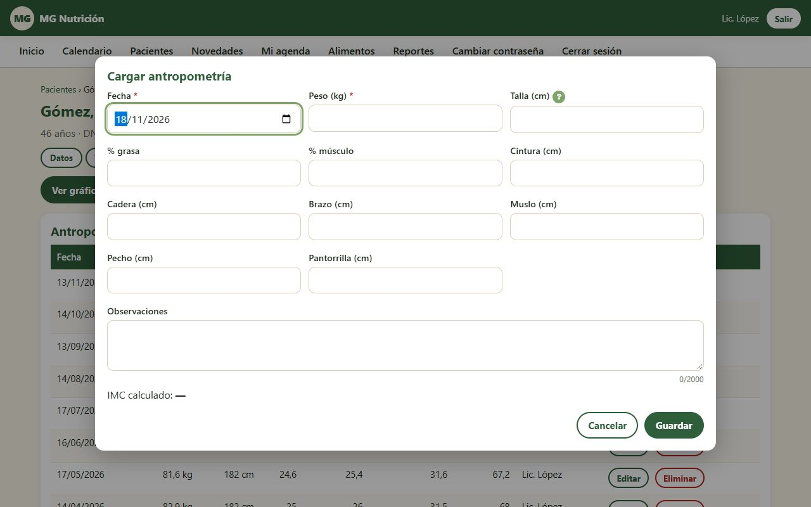

**Ver gráficos de evolución** muestra las curvas del paciente y permite descargar el reporte en PDF.

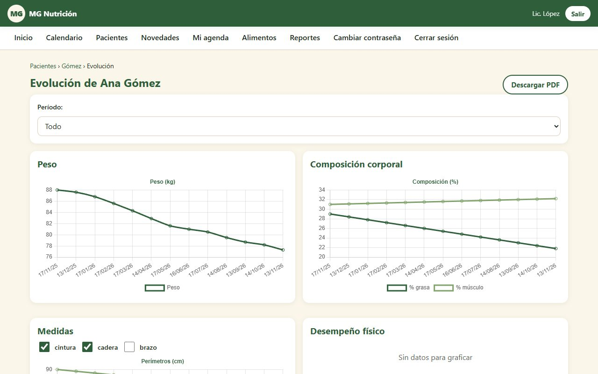

## Registros del paciente

La pestaña **Registros** resume las últimas 4 semanas: cumplimiento del plan, hambre y saciedad, comidas marcadas
como *no me gustó* o *me cayó mal*, reemplazos elegidos, comentarios y molestias.

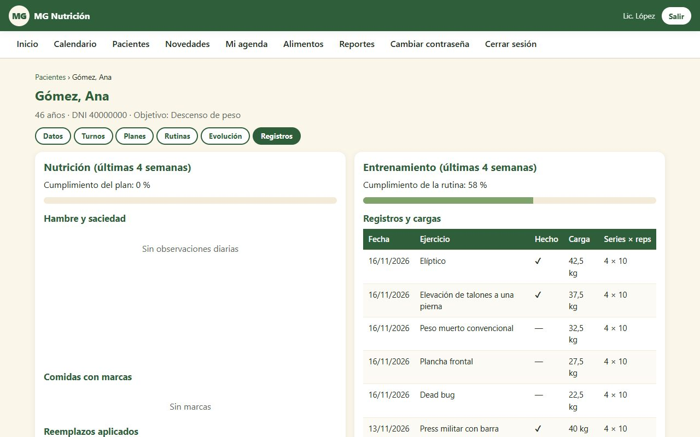

## Calendario y agenda

- **Calendario**: tus turnos por día, semana, mes o listado. Tocá un turno para ver el detalle, marcarlo como
  atendido o ausente, reprogramarlo o cancelarlo.
- **Mi agenda**: tus franjas semanales de atención (podés tener varias por día, sin superponerse) y los **bloqueos**
  por vacaciones o ausencias. Si un bloqueo afecta turnos ya dados, el sistema avisa y puede cancelarlos notificando a
  los pacientes.

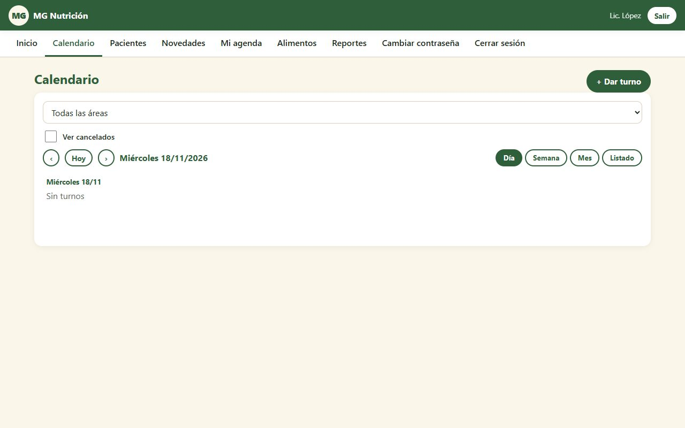

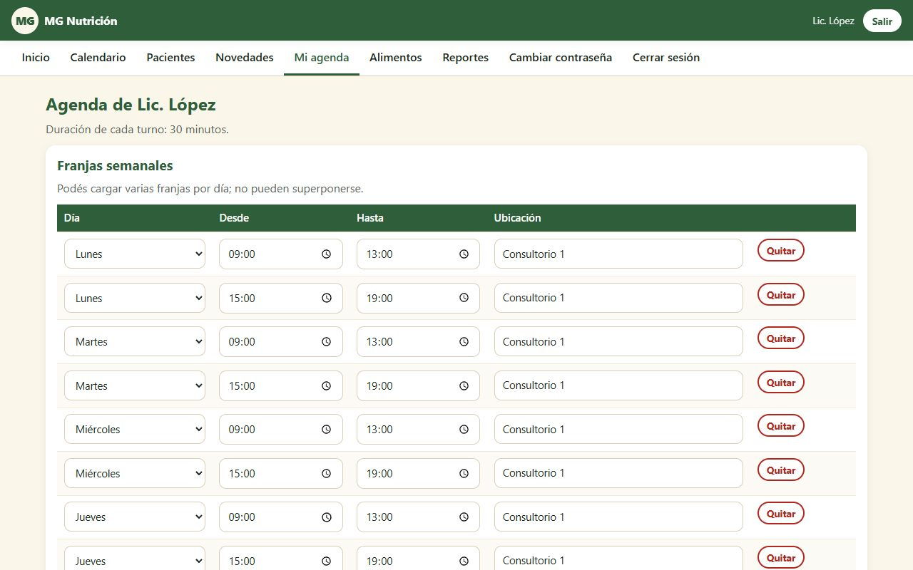

## Catálogo de alimentos

**Alimentos** lista el catálogo con sus valores cada 100 g y su medida casera. Podés dar de alta, modificar, dar de baja
y reactivar alimentos, y definir **equivalencias manuales** (tienen prioridad sobre las calculadas al sugerir alternativas).

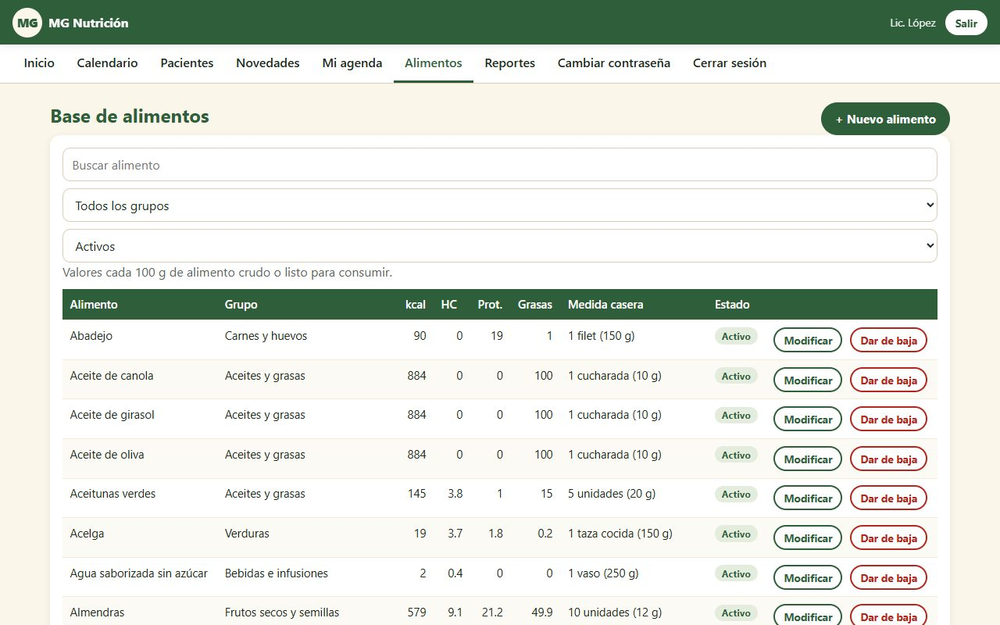

## Reportes

En **Reportes** podés generar el reporte de turnos, de evolución de un paciente y de planes alimentarios, en pantalla,
PDF o Excel (ver [Reportes](#reportes) en el capítulo del administrador).

# Entrenador

El entrenador usa las mismas pantallas de inicio, pacientes, ficha, calendario, agenda, novedades y reportes descriptas
para el nutricionista. Lo propio de su rol es:

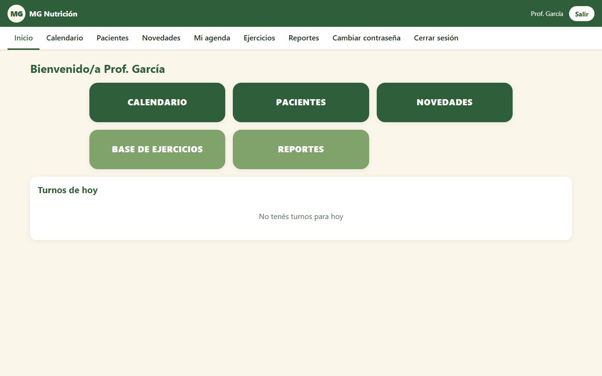

## Rutinas

En la ficha del paciente, pestaña **Rutinas**: historial de rutinas, **Nueva rutina**, **Editar rutina actual**,
**Duplicar** y **Eliminar**.

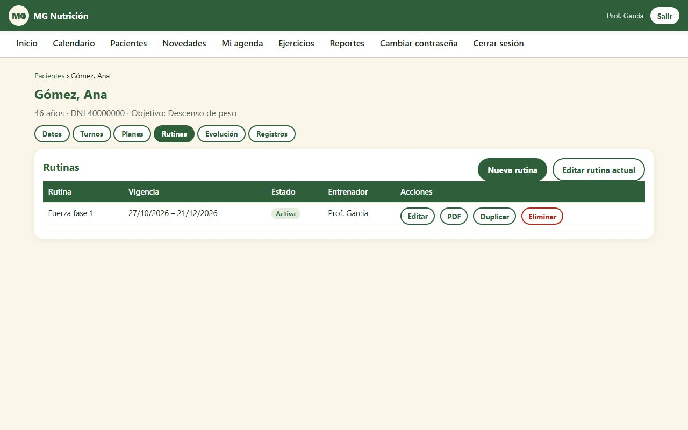

Para armar una rutina:

1. Completá nombre, objetivo, fecha de inicio, duración y observaciones.
2. **+ Agregar día** y elegí el día de la semana. Podés ponerle nombre (por ejemplo *Tren superior*) y **Duplicar día**.
3. **+ Agregar ejercicio**: buscá por nombre o filtrá por grupo muscular (🎬 indica que tiene video). Para cada
   ejercicio indicá series, repeticiones (por ejemplo *10*, *8-12* o *30 s*), descanso, carga sugerida y notas. Con
   ↑ ↓ cambiás el orden.
4. **Confirmar rutina**. Si el paciente ya tenía una activa, el sistema pregunta si querés finalizarla.

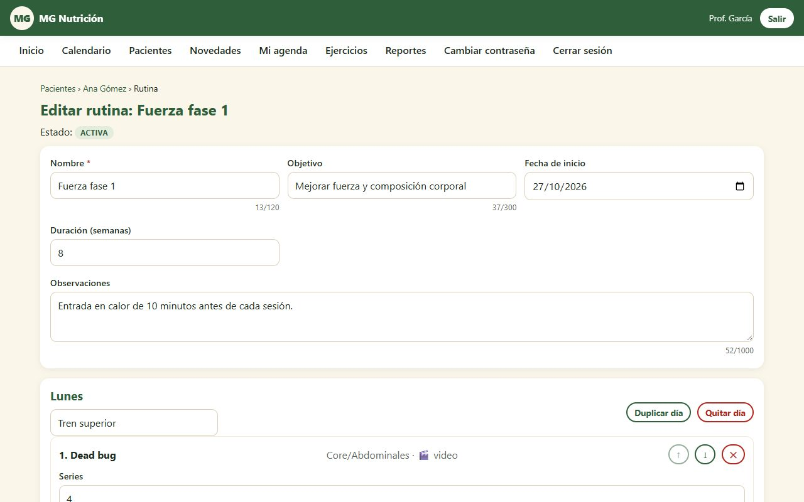

## Evaluaciones físicas

En la pestaña **Evolución** tocá **Cargar evaluación física**: fecha y una o más pruebas (por ejemplo *Sentadilla 1RM*)
con su valor y unidad. Alimentan el gráfico de desempeño del paciente.

## Molestias

Las molestias que reportan tus pacientes llegan a **Novedades**; las de intensidad 7 o más se marcan como prioritarias.
El detalle también figura en la pestaña **Registros** de la ficha, junto con las cargas registradas y las variantes elegidas.

## Catálogo de ejercicios

**Ejercicios** lista el catálogo con grupo muscular principal y secundarios, dificultad, equipamiento y enlace al video
(**Probar enlace** para verificarlo). Podés dar de alta, modificar, dar de baja y reactivar ejercicios.

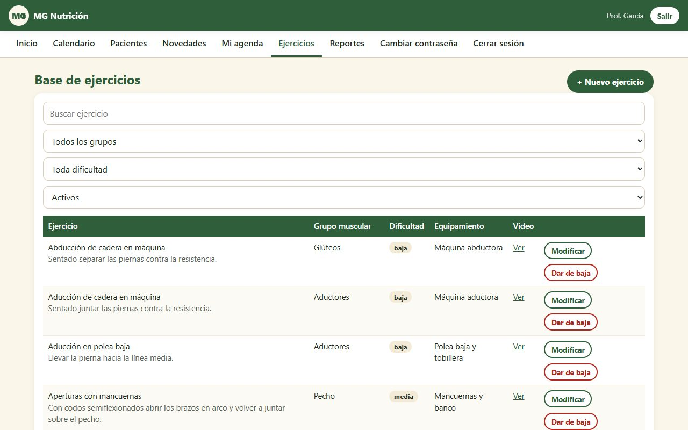

# Profesional integral

El profesional integral tiene los permisos del nutricionista y del entrenador a la vez: con los pacientes que tiene
asignados en ambas áreas arma planes y rutinas, carga mediciones y evaluaciones, y recibe todas sus novedades. Todas las
funciones están descriptas en los capítulos [4](#nutricionista) y [5](#entrenador).

# Administrador

## Inicio y alertas

El inicio da acceso a las áreas principales y muestra las **alertas** del sistema: credenciales que hay que entregar
a mano (cuando WhatsApp no está disponible), notificaciones fallidas, molestias, backups fallidos y profesionales dados
de baja con pacientes asignados. Tocá **Marcar leída** una vez resuelta cada una.

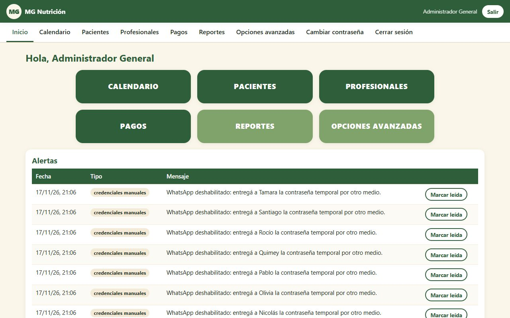

## Pacientes

**Pacientes** lista a todos con sus profesionales y su saldo.

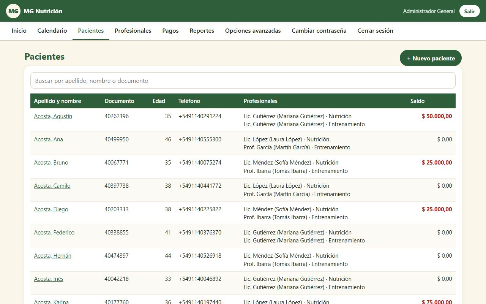

### Dar de alta un paciente

1. **+ Nuevo paciente**. Completá datos personales, teléfono de WhatsApp (con código de área), email, domicilio,
   objetivo, antecedentes de salud informados y observaciones. Los datos sensibles se guardan cifrados.
2. Opcionalmente, marcá los profesionales asignados por área.
3. **Registrar paciente**. Su usuario es el documento; la contraseña temporal se le envía por WhatsApp. Si no se pudo
   enviar, el sistema la muestra en pantalla para que se la entregues por otro medio.

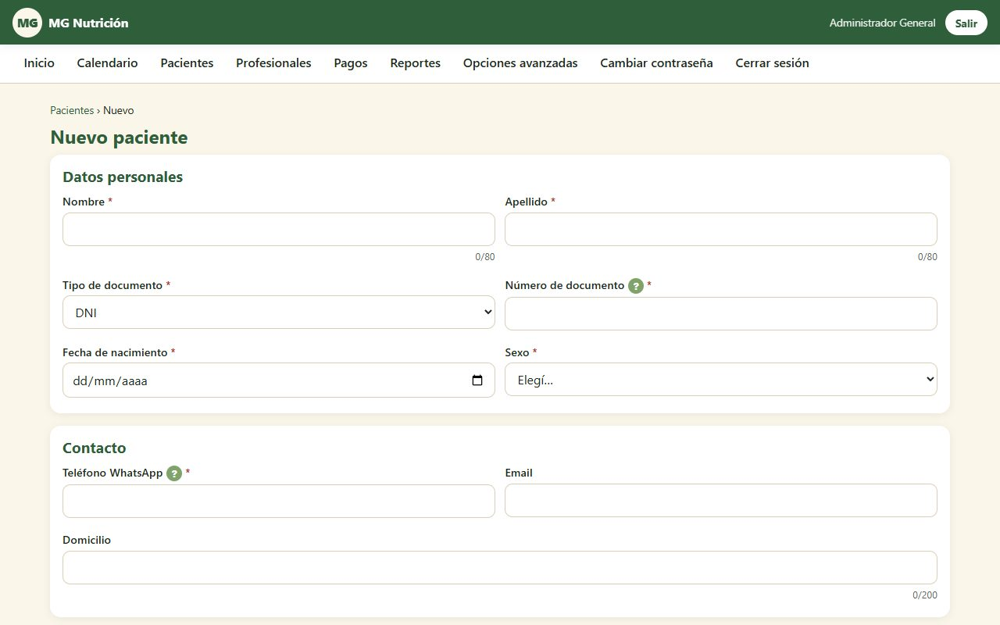

### Ficha, asignaciones y baja

Desde la ficha (pestaña **Datos**) podés **Modificar datos**, **Reenviar credenciales** (genera una nueva contraseña
temporal), **+ Asignar profesional**, **Desasignar** y **Dar de baja**. La baja quita el acceso, cancela los turnos
futuros (opcionalmente avisando por WhatsApp), quita sus profesionales asignados y **conserva todo el historial**.

Para ver a los pacientes dados de baja, marcá **Mostrar pacientes dados de baja** en el listado: aparecen con
«(Dado de baja)» junto al nombre. Desde su ficha, **Reactivar paciente** le devuelve el acceso con una contraseña temporal
nueva (se envía por WhatsApp). Después asignale de nuevo sus profesionales; los turnos cancelados no se restauran.

## Profesionales

**Profesionales** lista el equipo con su tipo, sus pacientes y si tiene agenda cargada.

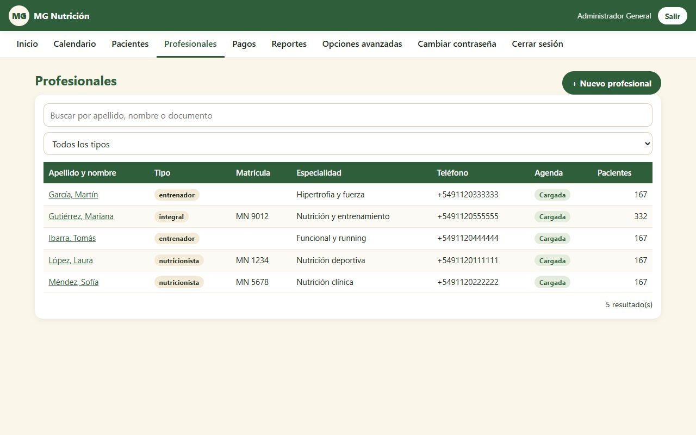

Para dar de alta uno: **+ Nuevo profesional**, completá los datos, elegí el **tipo** (nutricionista, entrenador o
integral; define sus permisos), la matrícula (obligatoria salvo para entrenadores) y la duración de sus turnos, y tocá
**Registrar profesional**. Recordá cargar su **Agenda** para que pueda recibir turnos.

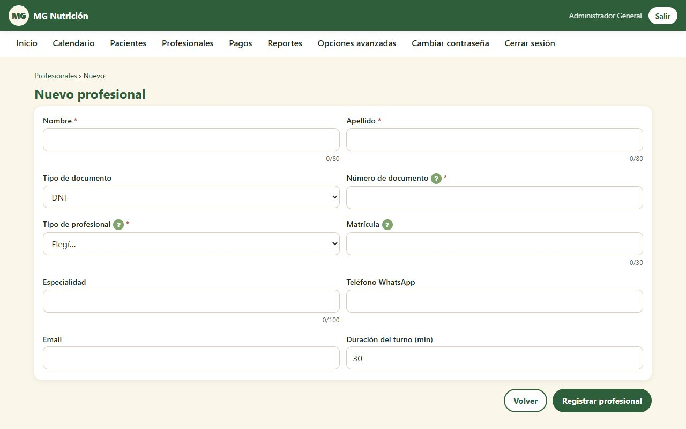

Al darlo de **baja** pierde el acceso, sus turnos futuros se cancelan y sus pacientes quedan sin profesional en esa
área (el sistema genera una alerta para reasignarlos).

## Calendario y turnos

El administrador ve los turnos de todos los profesionales, con filtros por profesional y área. **+ Dar turno**: elegí
paciente, profesional y horario libre. Sólo el administrador puede **forzar un horario fuera de agenda**. Desde el
detalle de un turno se lo marca atendido o ausente, se reprograma o se cancela indicando el motivo.

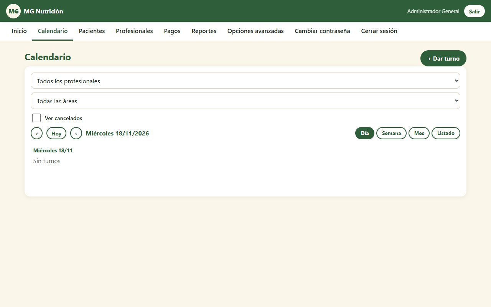

## Pagos

En **Pagos** buscá al paciente para ver su **cuenta corriente**: saldo, movimientos y saldo acumulado.

- **+ Registrar deuda**: elegí un arancel o escribí un concepto libre, período, monto, fecha y vencimiento.
- **+ Nuevo pago**: monto, fecha, medio (efectivo, transferencia, débito, crédito, Mercado Pago u otro) y referencia.
  Al registrarlo podés descargar el **comprobante** numerado en PDF.
- **Corregir** y **Anular**: requieren un motivo; el movimiento anulado queda tachado y no suma al saldo.
- **Historial de pagos** en PDF o Excel.
- **Generar cuotas del mes**: crea la deuda del arancel elegido a todos los pacientes activos.

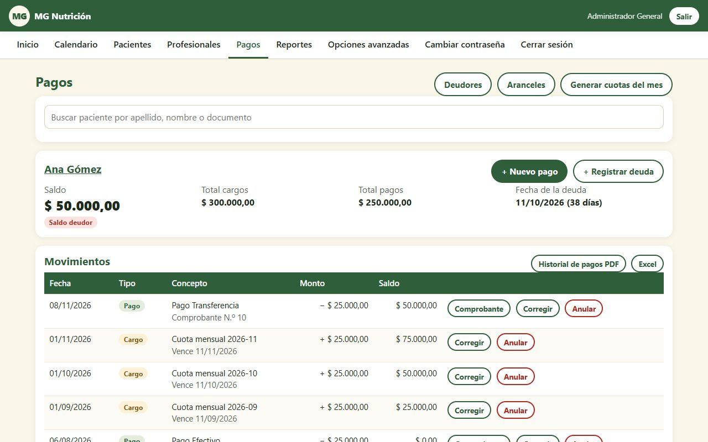

**Deudores** lista a los pacientes con saldo pendiente, días de atraso y teléfono, ordenable y exportable a PDF o Excel.
**Aranceles** define los conceptos y montos que se cobran.

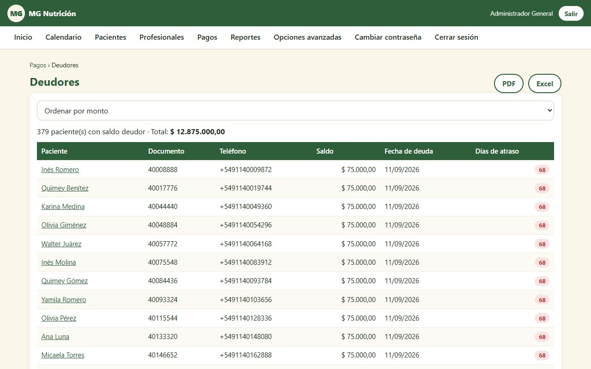

## Reportes

**Reportes** ofrece cinco reportes con filtros de fechas, profesional y paciente, en pantalla (con gráficos), PDF o Excel:

| Reporte | Contenido |
|---|---|
| Turnos | Atendidos, ausentes y cancelados; tasas por profesional |
| Pagos y deudas | Recaudación por medio de pago y deudas pendientes |
| Evolución del paciente | Mediciones, gráficos comparativos y desempeño |
| Rutinas | Cumplimiento, variantes, comentarios y molestias |
| Planes alimentarios | Comidas realizadas, reemplazos y hambre/saciedad |

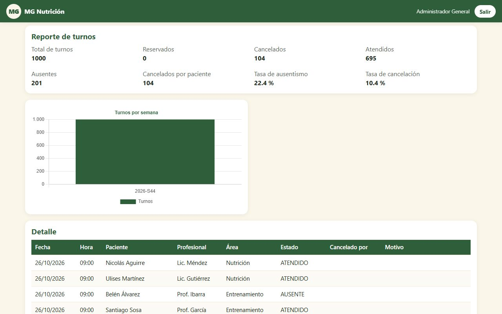

## Opciones avanzadas

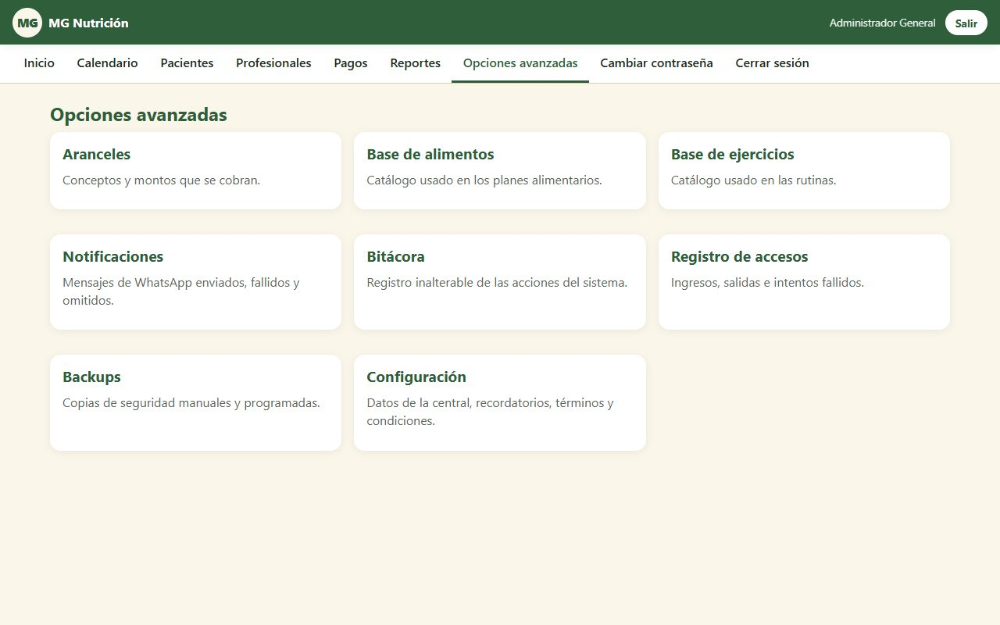

- **Bitácora**: registro inalterable de todas las altas, bajas, modificaciones, consultas sensibles, reportes y
  descargas, con usuario, fecha y resultado. Se filtra y se exporta a Excel.
- **Registro de accesos**: ingresos, salidas, intentos fallidos y bloqueos, con IP y navegador.
- **Notificaciones**: mensajes de WhatsApp enviados, fallidos y omitidos; **Reintentar** los fallidos y ejecutar a
  mano el **Recordatorio de turnos de mañana**, el **Recordatorio de deudas** y **Enviar pendientes**.
- **Backups**: **Generar backup** manual, descargar las copias y **programar** el backup automático (diario, semanal
  o mensual, con días de retención).
- **Configuración**: datos de contacto del centro, parámetros de recordatorios, mensaje de mantenimiento programado y
  publicación de una nueva versión de los **términos y condiciones** (todos los usuarios deberán aceptarla).
- **Alimentos** y **Ejercicios**: los catálogos descriptos en los capítulos 4 y 5.

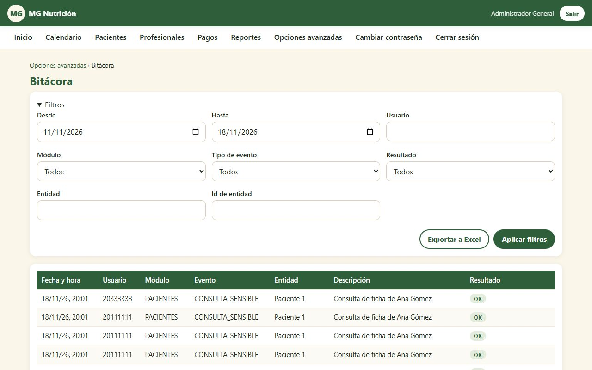

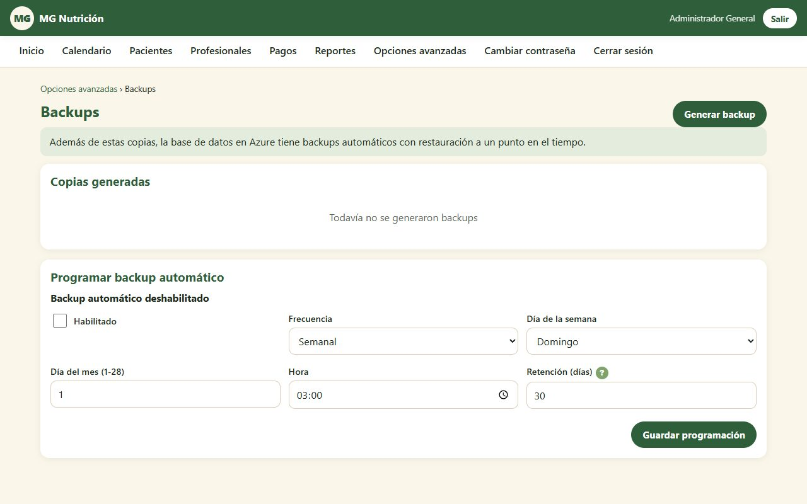

# Preguntas frecuentes y errores comunes

**«Usuario o contraseña incorrectos».** Revisá que el usuario sea tu documento sin puntos y que no esté activado el
bloqueo de mayúsculas. Si no la recordás, usá *¿Olvidaste tu contraseña?*

**«Tu cuenta quedó bloqueada temporalmente».** Hubo varios intentos fallidos seguidos. Esperá 15 minutos (el mensaje
indica cuánto falta) o recuperá la contraseña. Si sigue bloqueada, comunicate con el centro.

**«Tu sesión expiró».** Por seguridad la sesión dura 8 horas y se cierra al cerrar la pestaña. Volvé a ingresar.

**No me llegó el WhatsApp con la contraseña.** Verificá con el centro que tu número esté bien cargado. El
administrador puede reenviar las credenciales o entregarte la contraseña temporal por otro medio.

**«No se puede modificar con menos de 24 h de anticipación».** Los turnos se modifican o cancelan hasta 24 horas
antes. Comunicate con el centro por teléfono o WhatsApp.

**«Ya tenés un turno el …».** No se pueden tener dos turnos de la misma área con menos de
7 días de diferencia. Modificá el turno existente desde *Mis turnos*.

**«No hay horarios disponibles esta semana».** Probá con *Semana siguiente ›* o con otro profesional del área.

**«Todavía no tenés un plan alimentario / una rutina asignada».** Tu profesional todavía no confirmó el plan o la
rutina. Consultalo en tu próximo turno.

**«Consultá con tu nutricionista» al pedir una alternativa.** Ese alimento no tiene equivalentes cargados en el
catálogo; tu nutricionista puede agregar una equivalencia manual.

**«No hay conexión con el servidor».** Revisá tu conexión. En el registro del día, lo que marcaste se guarda y se
envía solo cuando vuelve la conexión.

**El plan no se puede confirmar.** Cada día debe tener al menos 4 comidas con contenido, y los porcentajes del
generador deben sumar 100 %.

**Un campo aparece en rojo.** El mensaje debajo indica qué corregir (por ejemplo, un teléfono sin código de área o un
documento ya registrado).
